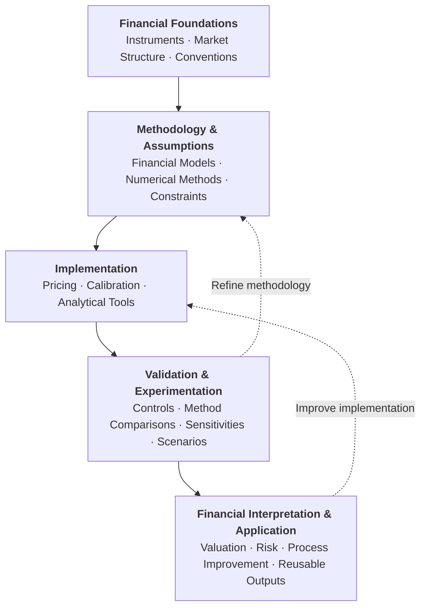

# Financial Implementations

**Financial modeling · Quantitative methods · Valuation · Risk · Applied research**

This repository brings together independent projects across financial disciplines, exploring how financial structures, market conventions, and quantitative methodologies translate into practical computational implementations.

The work goes beyond reproducing established formulas or algorithms. Each project examines the financial reasoning behind its implementation: how instrument characteristics and market conditions shape methodological choices, which assumptions determine the resulting outputs, and what those choices imply for valuation, risk, or financial analysis.

Through numerical experiments, sensitivity analysis, scenario testing, and methodological comparisons, I investigate how financial models behave under different assumptions and conditions, where their limitations emerge, and how their reliability or practical usefulness can be improved.

The overarching objective is to connect **financial understanding, quantitative implementation, and critical evaluation** to develop more transparent, reproducible, and useful analytical methods and workflows.

------------------------------------------------------------------------


## Approach & Workflow

The following workflow connects financial foundations, quantitative implementation, and critical evaluation.



The focus extends beyond implementing financial models to examining their reliability, assumptions, and practical implications. Independent validation, methodological comparisons, sensitivity analysis, and scenario experiments help identify limitations, explain differences in results, and evaluate opportunities to improve financial methods and workflows.

Each project documents its supporting evidence, assumptions, and limitations.

------------------------------------------------------------------------

## Current Projects

### Fixed Income

#### [MXN Yield-Curve Construction & Validation](fixed-income/yield-curves/)

**Interest-rate curves · Bootstrapping · Financial conventions · Calibration · Methodological analysis**

An implementation and research laboratory for constructing and evaluating MXN interest-rate term structures.

The current implementation develops an F-TIIE OIS curve-construction process, including instrument conventions, cash-flow generation, overnight compounding, pricing, discount-factor calibration, independent repricing, and validation controls.

The financial mechanics and calibration workflows are implemented directly in Python, using standard scientific libraries for numerical operations rather than relying on a prebuilt financial pricing engine.

Beyond curve construction, the project examines how calibration and interpolation choices influence implied rates, numerical stability, and sensitivity to market inputs.

Its analytical experiments investigate a central distinction: **different methodologies can reproduce the same calibration quotations while producing materially different term structures and sensitivities**.

The implementation provides calibrated curves, diagnostic outputs, and reproducible evidence for comparative methodological analysis and downstream financial applications.

[Explore project, methodology, results, and source code](fixed-income/yield-curves/)

------------------------------------------------------------------------

## Repository Structure & Potential Areas

The repository is organized by financial discipline. Each implementation maintains its own methodology, source code, and supporting evidence. Additional areas illustrate potential extensions rather than a fixed development roadmap.

``` text
financial-implementations/
│
├── fixed-income/
│   ├── yield-curves/           # Current
│   ├── bond-analytics/        # Potential
│   └── interest-rate-swaps/   # Potential
│
├── derivatives/               # Future
│   └── Options, Greeks, volatility, Monte Carlo
│
├── risk/                      # Future
│   └── Risk measures, scenarios, stress testing
│
└── corporate-finance/         # Future
    └── Business valuation, financial modeling
```

Additional financial implementations are incorporated as independent projects, preserving a coherent collection without requiring a common modeling approach across different financial problems.

------------------------------------------------------------------------

**Author:** [Luis Gerardo Canales](https://github.com/LuisGCanales)