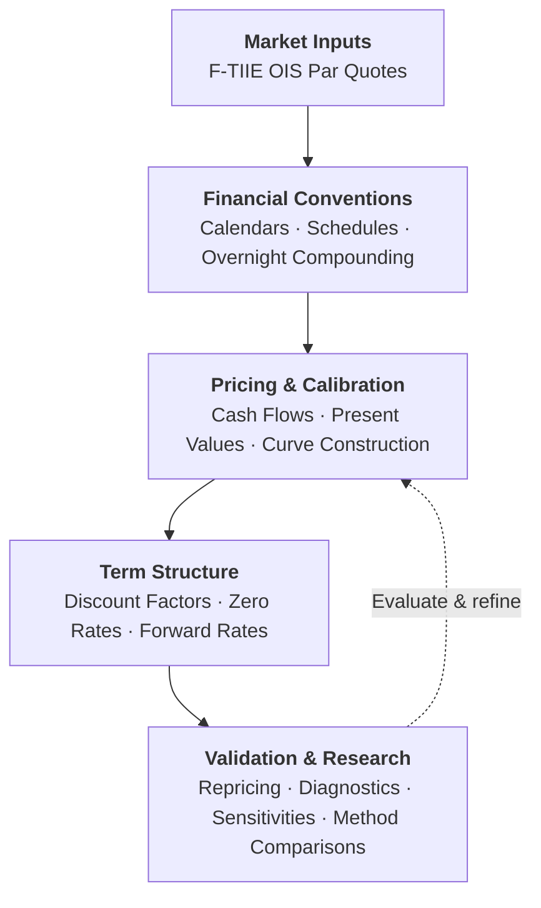
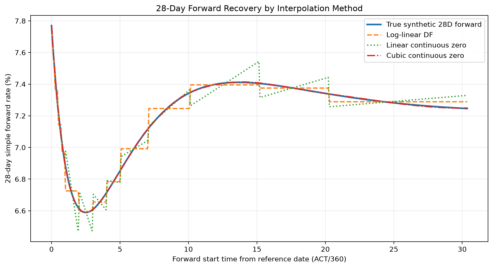
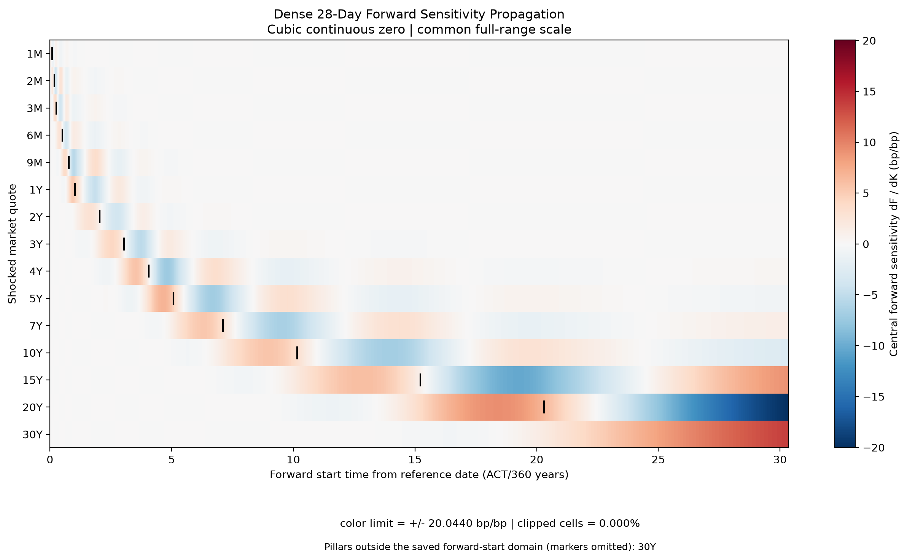

# Yield Curves — Construction, Calibration & Methodological Analysis

**Fixed Income · Interest Rates · Financial Engineering · Numerical Methods · Risk Sensitivities**

A financial engineering and research laboratory for constructing interest-rate term structures and investigating how financial conventions, calibration methods, and interpolation choices influence the resulting curves and their practical applications.

The project connects **instrument mechanics, financial pricing, numerical calibration, and analytical validation**. Beyond obtaining a curve that reproduces market quotations, it examines the behavior of the resulting term structure, its sensitivity to inputs, and the consequences of methodological assumptions.

The current implementation focuses on **MXN F-TIIE Overnight Indexed Swaps (OIS)**, using a single curve for projection and discounting. Its instrument mechanics, pricing calculations, calibration workflows, and validation controls are implemented directly in Python, with NumPy and SciPy providing general-purpose numerical tools.

---

## Financial Workflow

An OIS quotation is not itself a discount factor. Constructing a usable term structure requires translating contractual conventions into cash flows, valuing the instruments, and calibrating a curve that reproduces their quoted par rates.



The implementation makes these financial dependencies explicit and allows alternative numerical methodologies to be examined while preserving the underlying instrument definitions.

---

## Implementation

### Financial mechanics developed directly

Rather than calling a prebuilt financial curve-construction engine, I implemented the components required to represent and calibrate F-TIIE OIS instruments.

| Component | Implemented functionality |
|---|---|
| **Market conventions** | MXN business-day calendars, settlement adjustments, ACT/360 accrual, payment lags, and fixing rules |
| **Instrument construction** | Contractual dates, 28-day coupon schedules, fixed and floating legs, and cash-flow definitions |
| **Overnight compounding** | Daily fixing observations, calendar-day weights across weekends and holidays, and compounded floating coupons |
| **Pricing** | Projected floating coupons, discounted cash flows, swap present values, and par-rate calculations |
| **Curve calibration** | Sequential bootstrapping and simultaneous nodal calibration |
| **Validation** | Input checks, instrument reconstruction and repricing, numerical tolerances, acceptance states, and explicit failure handling |
| **Analytical research** | Interpolation comparisons, synthetic-reference recovery, forward-rate diagnostics, and quote-sensitivity analysis |

SciPy supplies numerical solvers and interpolation routines; NumPy supports numerical computation. The financial models, instrument conventions, cash-flow logic, calibration workflows, and validation processes are developed within the project.

This provides direct control over the assumptions connecting financial instruments to their calibrated term structures.

### Curve construction methods

The implementation supports two complementary calibration approaches:

- **Sequential bootstrap:** solves discount-factor nodes one at a time, retaining previously calibrated nodes under a local interpolation representation.
- **Simultaneous nodal calibration:** solves discount-factor nodes jointly against instrument repricing residuals, accommodating globally coupled interpolation methods.

The current selected baseline combines **simultaneous nodal calibration** with **natural cubic interpolation of continuously compounded zero rates**.

Alternative representations include log-linear discount-factor interpolation and linear interpolation of continuously compounded zero rates. PCHIP is also available as an experimental method outside the selected baseline.

The method selection reflects the conditions and trade-offs examined in this project, rather than a claim that one interpolation approach is universally superior.

[Explore calibration and interpolation methodology](docs/methodology.md)

---

## Analytical Evidence

**A curve can accurately reprice its calibration instruments without uniquely determining the term structure between observed maturities.**

The project investigates this distinction through synthetic-reference recovery, interpolation comparisons, and controlled perturbations of market quotations.

### Interpolation and forward-rate recovery



*Three interpolation methods calibrated simultaneously to 15 synthetic F-TIIE OIS quotations (1M–30Y). The figure compares their implied 28-day forward curves against the known synthetic reference.*

Despite near-exact repricing, forward-rate recovery differs materially:

| Method | Forward RMSE |
|---|---:|
| Log-linear discount factors | 3.811 bp |
| Linear continuous zero rates | 5.235 bp |
| Cubic continuous zero rates | 0.249 bp |

Cubic interpolation performs best in this smooth synthetic scenario, but its greater recovery accuracy comes with methodological trade-offs in sensitivity propagation.

### Quote sensitivity and risk propagation



*Signed changes in 28-day forward rates resulting from ±1 bp perturbations of individual calibration quotations. The heatmap shows how sensitivity can extend beyond the maturity of the shocked instrument.*

These experiments illustrate why **curve smoothness, calibration accuracy, and risk locality must be evaluated separately**.

[Methodology and results](docs/evidence/methodology.md) · [Sensitivity analysis](docs/evidence/risk.md) · [Complete evidence index](docs/evidence/index.md)

---

## Outputs & Usage

The calibrated curve provides **discount factors, continuously compounded zero rates, and forward rates**. Supporting outputs include independent instrument repricing, calibration diagnostics, acceptance status, and execution provenance.

The Python interface exposes the selected baseline directly:

```python
from yield_curves.baseline import build_baseline_ftiie_curve

result = build_baseline_ftiie_curve(
    quotes=quotes,
    calendar=calendar,
)

if result.accepted_for_use:
    curve = result.curve
```

The caller supplies the quotations and business calendar explicitly. The curve object can then be used for valuation or risk calculations within its supported date range.

[Python integration contract](docs/integration_contract.md) · [Output specifications](docs/snapshots.md)

---

## Reproducibility

The project includes frozen synthetic inputs, reproducible analytical experiments, automated tests, and documented numerical environments.

Using Python 3.11, from the repository root:

```bash
cd fixed-income/yield-curves
python3.11 -m venv .venv
source .venv/bin/activate
python -m pip install -e '.[dev,plots]'

DEMO_ROOT="$(mktemp -d)"
python scripts/demo/build_synthetic_baseline.py \
  --output-root "$DEMO_ROOT"

python -m pytest -q -m "not slow"
```

The demonstration uses **synthetic quotations and a projected MXN calendar**, not observed market data.

[Testing and environments](docs/testing.md) · [Reproduction details](docs/evidence/reproduce.md)

---

## Scope & Limitations

The current implementation is a financial-methodology laboratory, not a production market-curve service.

It focuses on MXN F-TIIE OIS under a **single-curve projection and discounting assumption**. The experimental results rely on synthetic inputs; calendar coverage has documented limitations, and extrapolation beyond calibrated maturities is unsupported.

Strong recovery under the selected smooth reference scenario does not establish real-market robustness or universal methodological superiority. The cubic baseline also exhibits global sensitivity effects that require consideration in risk applications.

[Financial conventions](docs/conventions.md) · [Assumptions and limitations](docs/assumptions_limitations.md)

---

## Documentation

| Area | Reference |
|---|---|
| Financial specifications | [Conventions](docs/conventions.md) |
| Curve construction | [Methodology](docs/methodology.md) |
| Experimental findings | [Evidence index](docs/evidence/index.md) |
| Validation | [Validation methodology](docs/validation.md) |
| Technical implementation | [Architecture](docs/architecture.md) |
| Downstream integration | [Python API](docs/integration_contract.md) |

---

## License

This subproject is licensed under the [MIT License](LICENSE), copyright © 2026 Luis Gerardo Canales Ocampo. The license applies to `fixed-income/yield-curves`, not automatically to the entire repository.