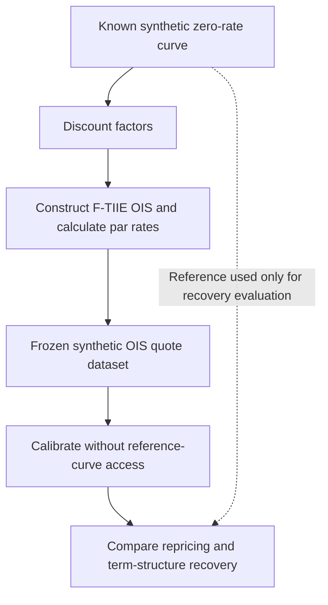

# Synthetic F-TIIE OIS Reference Data

This directory contains a **frozen, reproducible synthetic calibration dataset** designed to distinguish the ability to reprice OIS quotations from the ability to recover an underlying interest-rate term structure.

The dataset is **not observed Mexican market data**, a forecast of policy rates, an official CME curve, or an estimate of current fair-value quotations.

## Research question and construction

A calibrated curve can reproduce every quoted OIS while differing from another fitted curve **between observed maturities**. To study that identification problem, the project begins with a deliberately **smooth, non-flat, known reference zero-rate curve**, then generates synthetic F-TIIE OIS par quotations from it.

The *calibration engine* receives quotations and the required business calendar, **not the reference-curve function**. Knowledge of the original curve is retained for subsequent research comparisons.

## Known reference curve

For ACT/360 time $t$ measured from the common OIS effective date, the continuously compounded zero-rate function is

$$
z_{\mathrm{true}}(t)
=
L+S e^{-t/\tau_s}+H t e^{-t/\tau_h},
$$

with discount factors

$$
P_{\mathrm{true}}(t)
=
e^{-t z_{\mathrm{true}}(t)}.
$$

The frozen scenario uses the following model parameters:

| Parameter | Value | Interpretation |
|---|---:|---|
| $L$ | 0.0720 | Long-run zero-rate level (7.20%) |
| $S$ | 0.0060 | Short-end adjustment (0.60 percentage points) |
| $\tau_s$ | 1.50 years | Short-end decay scale |
| $H$ | -0.0030 | Medium-horizon curvature coefficient |
| $\tau_h$ | 4.00 years | Curvature decay scale |

The resulting term structure starts at a relatively elevated short end, declines through intermediate maturities, and gradually normalizes at long horizons. This deliberate smoothness enables a controlled comparison, **but may favor interpolation approaches that reproduce similar smoothness**.

The implementation is in [`research/curves.py`](../../src/yield_curves/research/curves.py) and [`research/synthetic.py`](../../src/yield_curves/research/synthetic.py).

## Frozen OIS quotation dataset

[`ftiie_ois_quotes_v1.csv`](ftiie_ois_quotes_v1.csv) contains **15 synthetic par quotations** across the following project-selected maturities:

`1M, 2M, 3M, 6M, 9M, 1Y, 2Y, 3Y, 4Y, 5Y, 7Y, 10Y, 15Y, 20Y, 30Y`.

Its trade date is **15 September 2026**, with a common effective/reference date of **18 September 2026**. Contractual dates, adjusted dates, final payment dates, and coupon counts are captured alongside the synthetic par quotations.

Each quotation is generated using the same project's F-TIIE OIS conventions:

1. Resolve the contractual tenor and construct the OIS schedule and overnight observations.
2. Project the floating coupon cash flows from the known discount-factor curve.
3. Discount the fixed- and floating-leg cash flows under the **same-curve projection/discounting assumption**.
4. Determine the fixed rate that equates the two present values.

Thus each generated contract is at par under the generating curve:

$$
PV_{\mathrm{float}}
=
PV_{\mathrm{fixed}},
\qquad
\operatorname{NPV}=0,
$$

up to numerical precision.

The dataset uses the **projected MXMC calendar** for the long horizon (2026–2057), not an independently verified future holiday source.

The CSV retains a `scenario_id` (`FTIIE_KNOWN_TRUTH_V1`) and `data_class` (`SYNTHETIC_REFERENCE_DATA`). These are research metadata, not market-feed identifiers. The calibration-facing financial fields are `tenor`, `trade_date`, `contractual_maturity_date`, and decimal `par_rate`.

## What the experiment establishes

The known curve permits two separate evaluations:

| Question | Evaluation |
|---|---|
| **Repricing** | Does the reconstructed curve reproduce the **synthetic par quotations** used in calibration? |
| **Recovery** | Does the reconstructed curve reproduce the **known generating discount factors, zero rates, and forward rates**, including between pillars? |

These questions are not equivalent. Different representations can achieve near-exact quote repricing while recovering different between-pillar forward curves.

The experiments also study how quote shocks propagate through each representation. Results depend on the smooth reference scenario, calibration approach, date grid, and sensitivity definition; they **do not establish real-market robustness**.

[Curve methodology](../../docs/methodology.md) · [Interpolation comparison](../../docs/evidence/methodology.md) · [Sensitivity evidence](../../docs/evidence/risk.md) · [Data-input contract](../../docs/input_contract.md)
