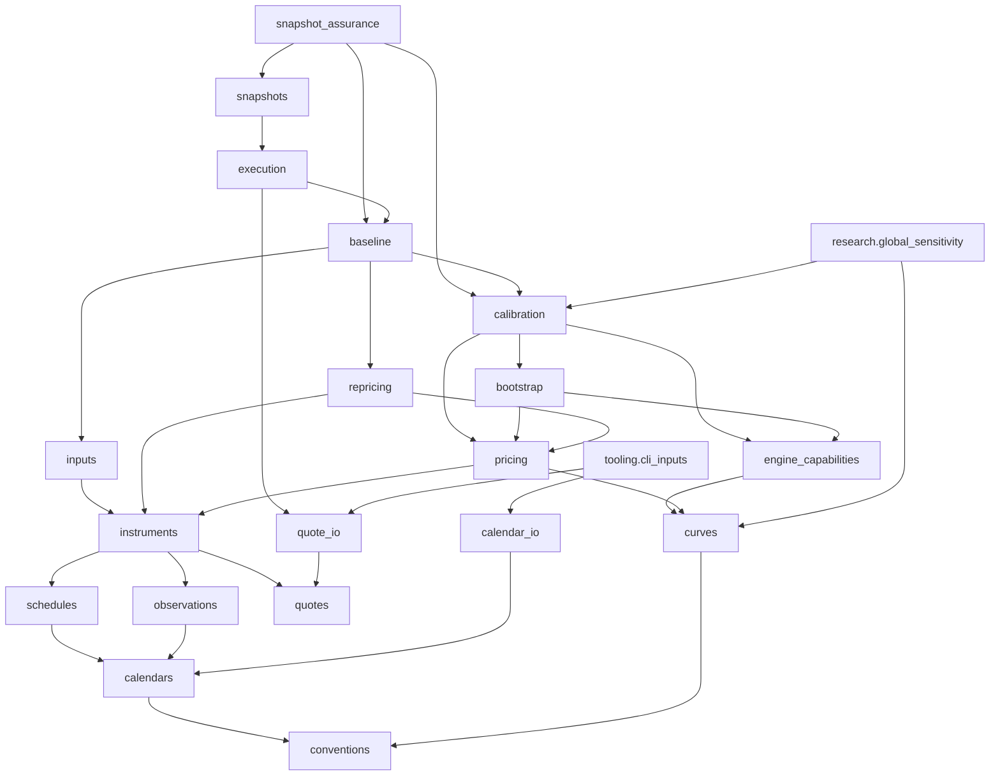

# Technical architecture

This is a navigation layer for the implemented MXN F-TIIE OIS Core-v1 library.
The operational baseline is simultaneous nodal calibration with
`CUBIC_CONTINUOUS_ZERO`, not the historical sequential curve. The financial
specifications remain in [conventions](conventions.md), [methodology](methodology.md)
and [interpolation](interpolation.md); acceptance and persistence details remain
in [validation](validation.md) and [snapshots](snapshots.md).

## Scope and consumer boundary

The public in-memory entrypoint is
[`baseline.build_baseline_ftiie_curve`](../src/yield_curves/baseline.py).
It takes explicit quotes and a covered `BusinessCalendar`, returning a
`BaselineResult` with curve, historical acceptance and financial context.
The [complete consumer example](integration_contract.md#complete-synthetic-in-memory-example)
needs no files, provenance adapters or synthetic research utilities. Check the
live `result.accepted_for_use` before querying DF, continuous zero or forward
rates within the supported reference-date-to-terminal-pillar interval.

There is no root-package re-export façade and no generic instrument plugin
registry. Reusable module interfaces are distinct from internal underscore
helpers, mutable spline internals and the internal engine capability table.
Checkout scripts are operational or research tooling, not installed console
commands. Use a complete editable checkout for scripts and version metadata;
financial research and engineering define the project scope.

## Module responsibilities

The following accounts for all **38 Python source modules**, including the three
namespace initializers. Paths are relative to `src/yield_curves/`; grouped rows
list every module explicitly. The source remains authoritative for behavior.

| Layer | Modules | Responsibility and boundary |
|---|---|---|
| Namespaces (3) | [`__init__.py`](../src/yield_curves/__init__.py), [`research/__init__.py`](../src/yield_curves/research/__init__.py), [`tooling/__init__.py`](../src/yield_curves/tooling/__init__.py) | Namespace docstrings; no API re-exports or workflow execution. |
| Financial definitions (2) | [`conventions.py`](../src/yield_curves/conventions.py), [`quotes.py`](../src/yield_curves/quotes.py) | Closed Core-v1 descriptors, ACT/360, zero-spread guard; four-field OIS quote protocol/value and neutral quote bumps. |
| Dates and contracts (5) | [`calendars.py`](../src/yield_curves/calendars.py), [`schedules.py`](../src/yield_curves/schedules.py), [`observations.py`](../src/yield_curves/observations.py), [`instruments.py`](../src/yield_curves/instruments.py), [`tenors.py`](../src/yield_curves/tenors.py) | Injected holidays/coverage, T+2, 28D periods/stubs/payment lags, overnight weights and realized compounding, aligned OIS legs, synthetic tenor offsets. No loaders in calendar domain. |
| Curve and valuation (3) | [`curves.py`](../src/yield_curves/curves.py), [`pricing.py`](../src/yield_curves/pricing.py), [`repricing.py`](../src/yield_curves/repricing.py) | DF protocol and representations; projected coupon/PV/par math; independent quote-to-instrument reconstruction and status classification without consuming solver residual containers. |
| Sampling and diagnostics (3) | [`date_grids.py`](../src/yield_curves/date_grids.py), [`diagnostics.py`](../src/yield_curves/diagnostics.py), [`log_linear_diagnostics.py`](../src/yield_curves/log_linear_diagnostics.py) | Inclusive versus complete-forward-period grids, sampled forward summaries and exact log-linear segment/jump math. No acceptance policy. |
| Construction engines (3) | [`bootstrap.py`](../src/yield_curves/bootstrap.py), [`calibration.py`](../src/yield_curves/calibration.py), [`engine_capabilities.py`](../src/yield_curves/engine_capabilities.py) | Sequential scalar solves; simultaneous log-DF least squares; explicit immutable method/engine compatibility. Capabilities neither construct curves nor select baseline policy. |
| Financial policy (2) | [`inputs.py`](../src/yield_curves/inputs.py), [`baseline.py`](../src/yield_curves/baseline.py) | Covered input preparation/immutable financial identity; fixed cubic construction, independent acceptance, captured policy and live payload binding. No file I/O. |
| I/O and execution (5) | [`quote_io.py`](../src/yield_curves/quote_io.py), [`calendar_io.py`](../src/yield_curves/calendar_io.py), [`execution.py`](../src/yield_curves/execution.py), [`snapshots.py`](../src/yield_curves/snapshots.py), [`snapshot_assurance.py`](../src/yield_curves/snapshot_assurance.py) | Parse/hash input bytes, separate provenance, workflow-issued envelopes, archive/publication/resolution, supported historical no-solve reassessment. |
| Synthetic research (3) | [`research/calendars.py`](../src/yield_curves/research/calendars.py), [`research/curves.py`](../src/yield_curves/research/curves.py), [`research/synthetic.py`](../src/yield_curves/research/synthetic.py) | Projected holidays, smooth known truth, generated quotes and synthetic CSV read/write. These are research tools, not operational dependencies. |
| Research assessment (3) | [`research/validation.py`](../src/yield_curves/research/validation.py), [`research/diagnostics.py`](../src/yield_curves/research/diagnostics.py), [`research/recovery.py`](../src/yield_curves/research/recovery.py) | Historical sequential VALID/REVIEW/INVALID, combined diagnostics, global/horizon known-truth recovery. Separate from current baseline acceptance. |
| Research shocks (2) | [`research/sensitivity.py`](../src/yield_curves/research/sensitivity.py), [`research/global_sensitivity.py`](../src/yield_curves/research/global_sensitivity.py) | Sequential one-sided/central and simultaneous central quote sweeps; response/curvature/locality diagnostics. |
| Checkout tooling (4) | [`tooling/cli_inputs.py`](../src/yield_curves/tooling/cli_inputs.py), [`tooling/project_paths.py`](../src/yield_curves/tooling/project_paths.py), [`tooling/reporting.py`](../src/yield_curves/tooling/reporting.py), [`tooling/reference_candidates.py`](../src/yield_curves/tooling/reference_candidates.py) | Explicit CLI adapters, checkout discovery, saved reports and exclusive numerical-candidate output. No financial calibration logic in reporting. |

## Import dependencies

Arrows below mean **actual imports**, not chronological execution. This selected
view omits repeated low-level edges and namespace nodes for readability.
`research.global_sensitivity` represents one concrete research consumer;
`tooling.cli_inputs` represents the CLI adapter, not all tooling modules.



[`tests/architecture/test_dependencies.py`](../tests/architecture/test_dependencies.py)
defines transitive constraints, not merely a preferred visual arrangement:

- Domain (including dates/diagnostics/tenors) cannot depend on construction engines.
  Core = domain plus `bootstrap`, `calibration`, `engine_capabilities`; core cannot
  depend on operational modules. Capabilities cannot depend back on either solver.
- Core and operational package modules cannot reach research or tooling.
  Core plus `inputs` and `baseline` cannot reach file adapters, execution, snapshots
  or assurance; their financial-context boundary excludes filesystem/JSON/hash I/O.
- Calendar domain has a stricter import allowlist and exposes no CSV loader.
  Operational/assurance scripts and `tooling.cli_inputs` have no synthetic research
  imports or repository-default input discovery.
- Research/tooling consume reusable interfaces from outside these boundaries.
  Research is not universally pure: synthetic CSV adapters perform file I/O.
  Historical comparison method tuples stay explicit.

An import is not evidence that financial calibration executed. Assurance imports
calibration result/check types and baseline policy; those imports transitively
load solver-containing modules. Its no-solve guarantee concerns the actual call
path, reinforced by static call restrictions and runtime no-call guards.

## Construction and execution flow

The financial flow is:

```text
Financial inputs -> validation/preparation -> OIS construction
  -> simultaneous calibration -> curve -> independent repricing -> acceptance
  -> execution binding -> snapshot publication
```

The last two stages belong to the execution workflow. The public in-memory
consumer stops at the accepted, live-bound baseline result.

1. `inputs.prepare_baseline_inputs` copies calendar financial values and normalized
   quotes, strips only outer tenor whitespace, checks at least two ordered unique
   quotes/maturities, finite rates, a common trade date and explicit coverage.
   It reconstructs instruments to visit actual observation/payment dates, derive
   a common effective reference date and strictly increasing final-payment pillars.
   Invalid quote inputs or uncovered dates can raise before any solve.
2. `instruments.build_calibration_ftiie_ois` builds zero-spread unit-notional OIS.
   Schedules distinguish contractual maturity, adjusted period ends and payment
   dates; observations carry overnight fixing weights across weekends/holidays.
   Pillars are final payment dates, not contractual maturities.
3. `calibration.calibrate_ftiie_ois_curve_simultaneously` solves `x_i = log(P_i)`;
   the factory maps `exp(x_i)` to the selected curve. Residuals are
   `(model_quote - market_quote) * repricing_scale_bp` (default `10_000`).
   Pricing passes the same curve for projection and discounting. Default initial
   DFs come from the historical log-linear sequential bootstrap; explicit valid
   starts bypass it. Invalid starts and engine failures have no silent fallback.
4. The baseline selects the natural cubic continuous-zero representation:
   `z_i = -log(P_i)/t_i`, `P(t) = exp(-z(t)*t)`, instantaneous `f = z + t*z'`.
   Time is ACT/360; the origin zero anchor is the first nodal zero. Queries cannot
   extrapolate beyond the final pillar or before the reference date.
5. `repricing.reprice_calibration_instruments` reconstructs OIS from quotes and
   recalculates par rates from the final curve. Independence is from solver
   checks/residuals, within this codebase; it is not external vendor validation.
   Baseline assessment checks structure, solver state and independent errors.
6. For operational delivery, `execution.build_baseline_execution` first captures
   source declarations, ID and UTC time **before** calling the baseline. After
   construction it issues an envelope binding inputs, provenance, financial
   context and historical acceptance. Sources are not retroactively attached to
   an arbitrary existing result and are not reread at publication.
7. `snapshots.export_baseline_snapshot` validates that envelope and supported
   standard policy, writes a complete archive, and promotes only accepted runs.
   A completed rejected standard execution may be archived without becoming current.

## State and error contracts

| State | Meaning | Does not establish |
|---|---|---|
| Valid inputs | Prepared quote/calendar/instrument geometry is admissible. | Solver success or source authenticity. |
| Successful optimizer result | Numerical optimizer reports success. | Correct structure, independent fit or operational acceptance. |
| Structurally valid curve | Expected class, method-related checks, counts, ordered positive finite nodes and input geometry are assessed. | All repricing PASS or market suitability. |
| Repricing PASS | Independent per-instrument absolute bp error is at most `0.01`. | Complete standard baseline acceptance or true-curve recovery. |
| Standard baseline acceptance | Successful solver, valid structure, nonempty finite independent checks all PASS, no issues, standard policy. REVIEW rejects use. | Current payload remains unchanged or publication was authorized. |
| Current live binding | `BaselineResult.accepted_for_use` combines historical acceptance with unchanged bound values/context/policy, including spline and solver state. | A new solve/repricing, authenticity or an execution envelope. |
| Publication authority | Workflow-issued envelope passes binding and supported standard-policy checks; accepted result is required for promotion. | That pointer replacement succeeded. |
| Persisted snapshot assurance | Supported archive resolves, reconstructs and independently matches historical V1 evidence without solving/writing. | Repeated optimizer history or market certification. |

A build can return a rejected result. Invalid inputs can raise before solving;
solver exceptions propagate. Standalone `assess_baseline_calibration` returns
issue-based rejection for bad financial inputs, but invalid tolerance configuration
raises. Explicit tolerance overrides select custom analytical assessment even if
numerically equal to standard defaults; neither custom nor isolated standard
assessment proves construction history or standard publication authority.
For issue codes, thresholds and failure handling, use [validation](validation.md).

## Publication, resolution and no-solve assurance

The caller owns `output_root`. Complete payloads and manifest are staged/fsynced,
then renamed under `runs/<run-id>/`. **Publication commits at
`os.replace(pointer_temp, root / "current.json")`.** An error after pointer
replacement, including root-directory fsync, may leave the accepted run current.
Before replacement the previous pointer remains current; after run rename a
complete unpublished archive may remain. A raised I/O exception alone does not
prove absence of publication. Accepted concurrent writers follow last pointer
replacement wins, with local POSIX filesystem assumptions.

`resolve_current_snapshot` reads the pointer once and verifies schema, identity,
manifest/inventory, checksums and accepted metadata. It returns a complete run path,
not a curve; missing/invalid current data has no legacy fallback.
`assess_current_snapshot` decodes supported historical V1 policy, reconstructs
cubic nodes without calibration, checks context/value bindings, reprices, and
compares fresh assessment with historical acceptance and CSV evidence. Stored
solver success remains a historical declaration. Hashes check integrity, not
source authenticity. [Snapshots](snapshots.md) owns schema, archive and detailed
commit/failure semantics; [CLI](cli.md) owns commands.

## Maintenance and evidence limits

Current solvers and shared repricing are same-curve, OIS-only. A pricing interface
with separate projection/discount parameters does not constitute integrated
multi-curve calibration. PCHIP is experimental and does not change the V1 baseline.
Synthetic recovery and shock studies do not establish broad market robustness,
real-calendar certification or production readiness.

Use [extension roadmaps](extending.md), [test contracts](test-coverage-map.md),
[testing/reference maintenance](testing.md), [limitations](assumptions_limitations.md)
and the canonical [C04 evidence index](evidence/index.md) for further work.
No validated Jupyter notebook exists; the runnable checkout demonstration is
[`build_synthetic_baseline.py`](../scripts/demo/build_synthetic_baseline.py).
Package `0.1.0`, baseline/acceptance V1 and snapshot schema `3.0` remain separate
identities; documentation maintenance does not revise them.
