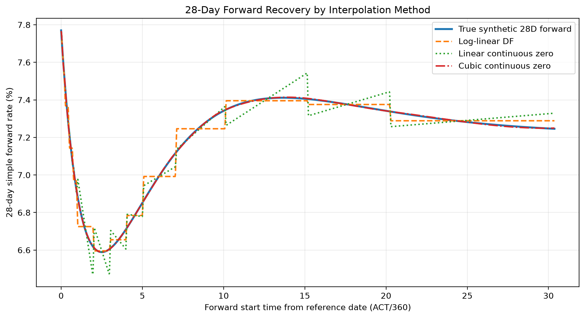
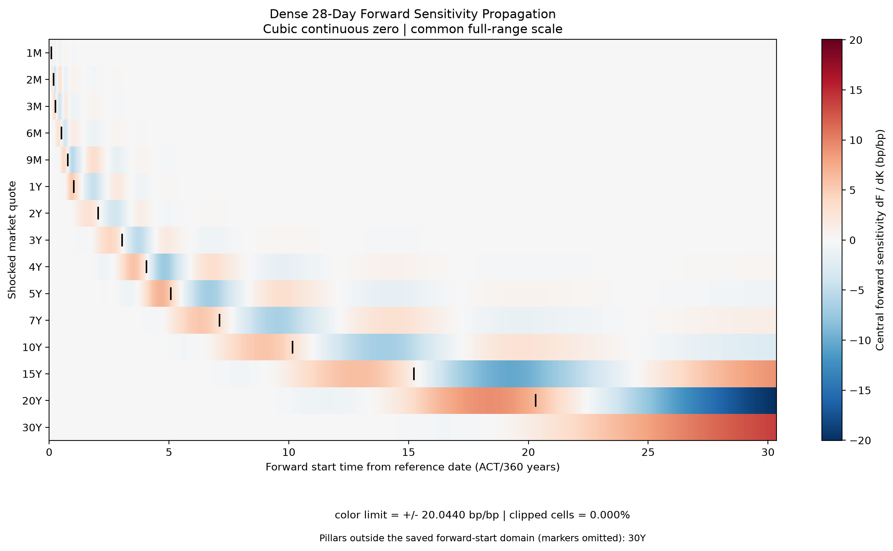

# Yield-Curve Research Evidence

This collection presents **financial and numerical evidence** for the MXN F-TIIE OIS curve-construction project. The experiments ask what it means to reproduce quoted instruments, how interpolation affects the resulting term structure, and how quote changes propagate through curve risk.

The common research setting consists of **15 synthetic F-TIIE OIS par quotations (1M–30Y)**, a **projected MXMC calendar for 2026–2057**, and one curve for both projection and discounting. Results describe a controlled model experiment, **not observed-market validation or production certification**.

## Research questions and findings

| Financial question | Evidence and interpretation |
|---|---|
| **Can the curve reproduce its OIS calibration quotations?** | [Valuation and acceptance](valuation.md) — 15 independent PASS checks for the selected simultaneous/natural-cubic baseline, with separately documented acceptance and snapshot limits |
| **Does perfect repricing determine the rates between pillars?** | [Calibration and interpolation](methodology.md) — three simultaneous calibration methods show extremely small par-rate errors but different discount-factor, zero-rate and 28-day-forward recovery |
| **Where does a quotation shock affect the curve?** | [Quote sensitivity and locality](risk.md) — signed responses to ±1 bp shocks, forward heatmaps and maturity-dependent locality, including an exception to a uniform cubic-versus-local ranking |

### Forward-curve recovery

*The [method comparison](methodology.md#g-original-forward-illustration-and-model-sensitivity) holds the simultaneous calibration engine and synthetic instruments fixed while changing the interpolation representation.*

### Quote-to-forward sensitivity

*The [risk analysis](risk.md#c-paired-forward-heatmap-presentation-derivatives) examines the signed central response of 28-day forwards to ±1 bp OIS quote shocks. This full-range panel displays the complete saved sensitivity range without clipping.*

## Inspect the underlying evidence

The repository contains **30 selected public exhibits**: 11 original valuation files and 19 methodology/risk files (17 original files and two reviewed figure-presentation derivatives). The two derivatives alter presentation, **not the financial matrices**.

| Source | Inspect |
|---|---|
| Calibration inputs and fitted pillars | [Synthetic quotations](../../evidence/c03/valuation/input_quotes.csv) · [Calibrated nodes](../../evidence/c03/valuation/curve_nodes.csv) |
| Independent repricing | [Selected baseline](../../evidence/c03/valuation/quote_repricing.csv) · [Sequential method](../../evidence/c03/bootstrap/independent_repricing.csv) |
| Recovery comparisons | [Three methods](../../evidence/c03/methodology/three_method_global_recovery.csv) · [By maturity horizon](../../evidence/c03/methodology/three_method_recovery_by_horizon.csv) |
| Signed sensitivities | [Global summary](../../evidence/c03/global/global_sensitivity_summary.csv) · [Cubic node responses](../../evidence/c03/global/node_zero_sensitivity_matrix_cubic_continuous_zero.csv) |
| Forward sensitivity and locality | [Heatmap scales](../../evidence/c03/heatmaps/forward_sensitivity_heatmap_scale_diagnostics.csv) · [Locality metrics](../../evidence/c03/locality/forward_sensitivity_locality.csv) |

This is a **curated subset**, not the full original research archive. Some original metadata contain machine-specific absolute paths and were withheld. The **complete accepted execution snapshot is also not distributed**: the three public quote/node/repricing payloads are standalone exhibits and cannot, by themselves, be passed to snapshot assurance.

## Reproducibility and provenance

The original financial computation, the later selection of public artifacts, and subsequent saved-data replay are **separate activities**. The recorded saved-data replay verifies selected heatmap and locality consumers using two compressed input matrices **without recalibrating**; it does not establish a full financial recomputation.

[Reproduction instructions](reproduce.md) distinguish inspecting public artifacts, rerunning selected saved-data consumers, and optional full financial recomputation.

| Detailed record | What it preserves |
|---|---|
| [Claim and limitation register](claims.md) | Scope of verifiable financial statements |
| [Valuation claims](claims-valuation.md) · [Methodology/risk claims](claims-methodology-risk.md) | Exact result identifiers, original checks and file hashes |
| [Unified machine index](../../evidence/c03/index.json) | Selection and publication information at curation time |
| [Valuation manifest](../../evidence/c03/valuation-manifest.json) · [Methodology/risk manifest](../../evidence/c03/methodology-risk-manifest.json) | Original inputs, artifact identities, figure derivation and withheld files |
| [Saved-data transport manifest](../../evidence/c03/replay-inputs.json) | Compressed consumer inputs and recovered raw-file checksums |

**Publication boundary:** Only selected exhibits are publicly inspectable. Original acceptance metadata, the full bound snapshot and some audit receipts remain in the external archive. Checksums and manifests support integrity and provenance within their stated scope, **not source authentication, independent vendor pricing or trusted execution timestamps**.

The recorded financial-execution source revision is `bee31fd0883660f171ebe84817b98641239eae5b`; the reference environment is documented in the [reproduction contract](reproduce.md). The source revision is retained for audit, not as a development stage the reader must understand.
