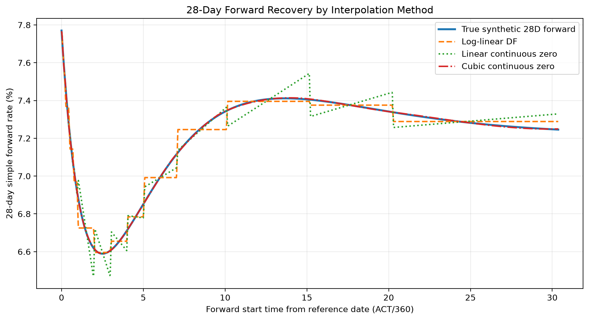

# Calibration and Interpolation — Experimental Evidence

**An OIS curve can fit its quoted instruments almost exactly while producing materially different forward rates between calibration maturities.** This study isolates that issue by holding the financial instruments and **simultaneous calibration engine** fixed while changing the interpolation of the calibrated term structure.

The analysis uses saved, reproducible **synthetic** evidence. It does not claim new computation, observed-market validation or that the selected interpolation is universally superior.

[Evidence overview](index.md) · [Financial methodology](../methodology.md) · [Exact claims and artifact provenance](claims-methodology-risk.md) · [Source manifest](../../evidence/c03/methodology-risk-manifest.json)

## A. Financial question and scenario

To create a known reference against which a recovered curve can be measured, the project generates a **smooth, non-flat continuous zero-rate curve** with a high short end, intermediate decline and long-horizon normalization. It uses that reference to price 15 F-TIIE OIS contracts at par and stores the resulting **synthetic 1M–30Y quotations**.

The experiment has trade date **15 September 2026**, effective/curve reference date **18 September 2026**, and final OIS payment pillar **20 September 2056**. Calendar construction uses a **projected MXMC calendar for 2026–2057**, not an official future holiday dataset. Projection and discounting share one curve.

The calibration engines receive **only the synthetic par quotations and relevant calendar**. The known generating curve is used **after calibration** to evaluate how well the recovered curve matches the reference between pillars. This distinction makes the experiment an interpolation/recovery study rather than an observed-market backtest.

[Scenario specification](../../data/synthetic/README.md) · [Frozen quotations](../../data/synthetic/ftiie_ois_quotes_v1.csv)

## B. Sequential bootstrap and simultaneous calibration

The project implements both:

- **Sequential bootstrap:** solve the next discount factor while earlier nodes remain fixed, using a compatible local interpolation method.
- **Simultaneous nodal calibration:** optimize all discount factors jointly to reproduce the par rates of the full instrument set.

The separate [sequential log-linear study](valuation.md#g-sequential-bootstrap-benchmark) demonstrates the first approach. **The three-method comparison in this document uses simultaneous calibration for all three methods**, including log-linear discount factors. This isolates the interpolation choice without confusing it with differences between calibration engines.

[Saved simultaneous solver diagnostics](../../evidence/c03/methodology/simultaneous_calibration_diagnostics.csv) report three successful base calibrations. Numerical convergence and quote repricing do not establish recovery of the synthetic truth between pillars.

## C. Interpolation choices

| Method | Financial representation and potential implication |
|---|---|
| **Log-linear discount factors** | Linear interpolation of $\ln P(t)$; piecewise-constant instantaneous forward rates between pillars, with possible jumps |
| **Linear continuous zero rates** | Linear interpolation of $z(t)$; continuous zero rates, with changes in the implied instantaneous forward at interpolation knots |
| **Natural cubic continuous zero rates** | Natural cubic interpolation of $z(t)$; smoother instantaneous forwards, but **globally coupled** response to nodal changes |

The continuously compounded zero rate satisfies

$$
z(t)=-\frac{\ln P(t)}{t},
\qquad t>0.
$$

The saved experiment compares only these three representations. **PCHIP is available elsewhere in the implementation but was not included in this saved method-selection experiment.** The smooth reference scenario may favor a representation that reproduces similar smoothness.

[Complete interpolation properties](../interpolation.md)

## D. Quote fit and known-truth recovery

All three simultaneous calibrations achieve extremely small **synthetic OIS par-rate repricing errors**, while the 28-day forward-rate recovery errors differ materially.

The saved global comparison reports:

| Interpolation | Max quote error (bp) | Dense DF RMSE | Zero RMSE (bp) | 28D forward RMSE (bp) |
|---|---:|---:|---:|---:|
| Log-linear discount factors | 5.45397e-11 | 0.0001631194 | 0.513551 | **3.811010** |
| Linear continuous zero rates | 1.60982e-11 | 0.0002052785 | 0.550615 | **5.234591** |
| Natural cubic continuous zero rates | 4.38538e-11 | 0.0000090177 | 0.139496 | **0.249318** |

[Exact original data, full numeric precision](../../evidence/c03/methodology/three_method_global_recovery.csv) · [Calibration diagnostics](../../evidence/c03/methodology/simultaneous_calibration_diagnostics.csv)

In this smooth synthetic setting, cubic interpolation recovers the known 28-day forward curve more closely. But **near-exact repricing does not discriminate between the methods**, and smaller global recovery error does not automatically imply better behavior under quote shocks or noisy observations.

These numbers belong to the **three-method simultaneous study**. The independently recorded sequential log-linear study has its own numerically close, but not identical, recovery RMSE; the two outputs must not be treated as one run.

## E. Recovery metrics and grids

Let $F(T_1,T_2)$ denote the simple forward rate over an ACT/360 accrual interval:

$$
F(T_1,T_2)
=
\frac{P(T_1)/P(T_2)-1}{\tau_{\mathrm{ACT/360}}(T_1,T_2)}.
$$

For this experiment, $T_2$ lies **28 calendar days** after $T_1$. Forward-start dates are generally sampled every seven days.

Recovery compares model output with the known generating curve. Discount-factor errors are **dimensionless**; relative discount-factor errors are in **ppm**; zero-rate and forward-rate errors are measured in **basis points**. MAE and RMSE report different aspects of recovery, and the maximum reveals isolated larger deviations.

**Sampling details matter.** The archived studies have different date-grid endpoints:

| Saved calculation | Sampling domain | Observations |
|---|---|---:|
| Three-method discount-factor recovery | Reference date to final payment pillar, including endpoint | **1,567** |
| Three-method zero-rate recovery | Same weekly grid, excluding the undefined $t=0$ zero-rate observation | **1,566** |
| Three-method 28-day forward recovery | Weekly starts to **23 August 2056**, ending at the payment pillar | **1,563** |
| Global forward-sensitivity study | Weekly starts to **18 August 2056**, ending 28 days later | **1,562 per shock/method** |

A separate zero-rate **figure** uses a one-day-shifted grid starting **19 September 2026**, rather than the weekly zero-rate metrics grid. The synthetic-reference reporting workflow also has its own contractual-horizon rule.

**Identical calibration inputs do not imply identical sampling grids.** Differences in terminal starts, forward horizons, and observation counts should be retained when interpreting metrics or comparing saved outputs.

## F. Horizon-dependent errors

Recovery is also analyzed by maturity horizon: **0–1Y, 1–5Y, 5–10Y and 10Y–curve-end**. The original table contains 12 method/horizon rows and separate counts for discount factors, zero rates and forwards.

| Horizon | Log-linear DF 28D RMSE (bp) | Linear-zero 28D RMSE (bp) | Cubic-zero 28D RMSE (bp) |
|---|---:|---:|---:|
| 0–1Y | 3.981169 | 1.550536 | **0.712921** |
| 1–5Y | 4.482452 | 6.335478 | **0.112706** |
| 5–10Y | 6.790079 | 2.875255 | **0.200265** |
| 10Y–curve-end | 2.329280 | 5.561099 | **0.234218** |

[Exact horizon results and observation counts](../../evidence/c03/methodology/three_method_recovery_by_horizon.csv)

Log-linear discount factors and linear continuous zero rates **change their ordering by horizon**. Cubic retains a substantially smaller forward RMSE in these saved buckets, but its maximum short-end zero-rate error still reaches **4.3578828369653095 bp**. Global RMSE alone can hide local errors and boundary effects.

## G. Original forward illustration and model sensitivity

*Original saved comparison of 28-day simple ACT/360 forwards. Horizontal axis: forward-start years from the effective reference date. Vertical axis: annual forward percentage. All three methods use simultaneous calibration. The visibly close cubic/reference curves are **not mathematically identical**; inspect the tables above for error magnitude.*

The figure is an unchanged original exhibit generated from the synthetic scenario. Its separate plotting workflow recalibrates the three methods and produces dense data; **it is not a saved-data-only consumer** and is not covered by the heatmap/locality replay procedure.

Smooth-curve recovery and **quote-to-curve sensitivity** are different aspects of methodology. The [risk experiments](risk.md) examine local finite differences, global coupling, forward-rate response and sensitivity locality. Better synthetic recovery does **not** necessarily imply better hedge localization.

## H. Provenance and limitations

The public set contains original, byte-identical calibration and recovery tables/figures. One original metadata file was withheld because it contains machine-specific paths; the [manifest](../../evidence/c03/methodology-risk-manifest.json) retains its source hash and separately authored description. This description is **not a replacement for the unavailable original metadata**.

The original financial execution used source revision `bee31fd0883660f171ebe84817b98641239eae5b` and a recorded Python 3.11.15 / NumPy 2.4.6 / SciPy 1.17.1 / Matplotlib 3.11.2 environment. The saved financial calculations and later public exhibit selection are separate activities; this document makes **no new financial recomputation claim**.

The [reproduction guide](reproduce.md) validates a limited saved-data replay of **global sensitivity heatmap/locality consumers**, not a full replay of these calibration/recovery experiments. The original dense plotting source and some execution/audit evidence remain external.

**Scope:** one smooth synthetic term structure, a projected calendar, same-curve projection/discounting, and three tested interpolation representations. These results do not demonstrate universal cubic superiority, real-market robustness, certified calendar coverage, portfolio P&L, or production suitability.
