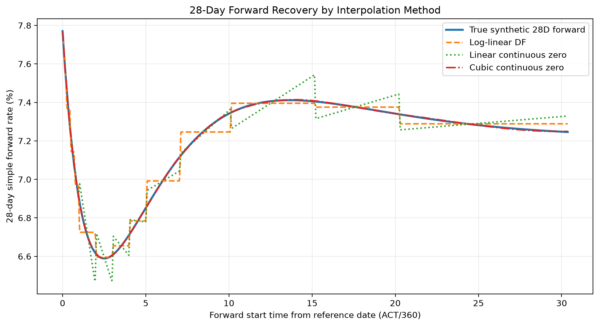

# Methodology and interpolation evidence

[Evidence index](index.md) · [Risk evidence](risk.md) · [Claims C07–C14](claims-methodology-risk.md) · [Original identities and provenance](../../evidence/c03/methodology-risk-manifest.json)

This C04c review package curates previously validated C03 results. Its classification is **`VALIDATED_RESEARCH_EVIDENCE`**. Original financial source commit: `bee31fd0883660f171ebe84817b98641239eae5b`. Historical C04c curation began from repository commit `39f24aff2e2c5e13d2eb53ab43d4fee53cc18dae`; that documentation commit is distinct from the financial execution and subsequent PR commits. Original execution times and the separate C04c curation timestamp are recorded in the manifest. No financial results were generated during curation. The [current PR publication state](index.md#publication-state) is separate from those historical records.

## A. Financial question and scenario

How much does interpolation affect the curve recovered from a fixed set of par quotes, even when those quotes reprice closely? The controlled experiment uses **`FTIIE_KNOWN_TRUTH_V1`**, 15 synthetic MXN F-TIIE OIS quotes from 1M to 30Y, trade date **2026-09-15**, and reference/effective date **2026-09-18**. The final payment pillar is **2056-09-20**. The calendar is the project's projected MXMC model for 2026–2057; its future holidays are not official market-calendar evidence.

Core-v1 uses a **single curve for projection and discounting** ([C07](claims-methodology-risk.md#c07)). Synthetic known truth is introduced **after calibration** to assess recovery. A research column named `market_quote` remains a synthetic calibration observation. The original [quote input](../../data/synthetic/ftiie_ois_quotes_v1.csv), its hash, projected-calendar source hash and known-truth source hash are recorded in the manifest. C04b's [input and convention discussion](valuation.md#b-synthetic-financial-inputs) supplies the valuation context.

## B. Sequential bootstrap and simultaneous calibration

The historical local benchmark uses sequential `LOG_LINEAR_DF` construction: solve each terminal discount factor with Brent's method while freezing earlier nodes. This explains the upstream invariance observed in Section 05. See the existing [sequential benchmark](valuation.md#g-sequential-bootstrap-benchmark); its validation contract remains distinct from the operational cubic baseline's acceptance policy.

The three-method comparison uses **simultaneous nodal least squares for every method**, including log-linear DF. It solves the nodal state together against the same 15 synthetic instruments. This controls the calibration engine when comparing interpolation methods; it does not make the sequential and simultaneous workflows identical. [M01 calibration diagnostics](../../evidence/c03/methodology/simultaneous_calibration_diagnostics.csv) contains three method rows with saved solver success and repricing errors. Numerical termination, quote repricing, project acceptance and recovery of latent truth answer different questions.

## C. Interpolation choices

| Method | Representation and implication |
| --- | --- |
| `LOG_LINEAR_DF` | Linear interpolation of log discount factors; constant instantaneous forwards within a segment can produce steps across pillars. |
| `LINEAR_CONTINUOUS_ZERO` | Linear interpolation of annual continuous zero rates; the implied forward shape differs from log-linear DF even at the same nodal maturities. |
| `CUBIC_CONTINUOUS_ZERO` | Natural cubic spline in continuous zero rates; smoothness couples intervals and can propagate quote response away from the shocked pillar. |

The relationship is `z(t) = -ln(P(t)) / ACT360(reference,t)`. Discount factors are dimensionless; zero rates are annual decimals. See the existing [curve methodology](../methodology.md) for the source model. The saved study uses common reference/node dates and no automatic extrapolation. A smooth latent truth makes comparable smoothness favorable in this scenario; smoothness alone establishes neither universal accuracy nor desirable risk localization.

## D. Quote fit and known-truth recovery

The existing [C04b fit/recovery discussion and claim C06](valuation.md#h-fit-versus-known-truth-recovery) explains why close instrument fit can coexist with nonzero between-pillar errors. Those original C01–C06 claims and exhibits are unchanged.

Within **M02 only**, the three simultaneous calibrations all succeed and show very small quote-fit errors, while forward recovery differs materially ([C08](claims-methodology-risk.md#c08)). The following numbers are saved observations at their recorded precision in [M02](../../evidence/c03/methodology/three_method_global_recovery.csv).

| Simultaneous method | Max quote repricing error (bp) | Dense DF RMSE | Zero RMSE (bp) | 28D forward RMSE (bp) |
| --- | ---: | ---: | ---: | ---: |
| `LOG_LINEAR_DF` | 5.4539706084710815e-11 | 0.00016311943905302783 | 0.5135510024409465 | 3.811009931078169 |
| `LINEAR_CONTINUOUS_ZERO` | 1.609823385706477e-11 | 0.00020527847355579092 | 0.5506156603716557 | 5.23459080351771 |
| `CUBIC_CONTINUOUS_ZERO` | 4.3853809472693683e-11 | 9.01769794977949e-06 | 0.13949647711663368 | 0.24931760566157052 |

This establishes a recovery difference under this engine, grid and smooth synthetic scenario. It does not establish universal cubic superiority, observed-market suitability, multi-curve validation or production readiness. The separate sequential forward RMSE in C04b is **3.8110099310701564 bp**; preserve that workflow identity rather than substituting M02's simultaneous value.

## E. Recovery metrics and grids

Recovery errors compare recovered and true values: absolute DF error is dimensionless, relative DF error is ppm, and zero/forward errors are bp. RMSE emphasizes large deviations; MAE describes average absolute error; the saved maximum exposes tail deviations. These are curve approximation measures, not currency P&L or portfolio risk. The forward is the **28-calendar-day simple ACT/360 rate** `F(T1,T2) = (P(T1)/P(T2) - 1) / ACT360(T1,T2)`.

| Original workflow/product | Saved sampling and endpoints |
| --- | --- |
| M02/M03 recovery metrics | Seven-day reference-date grid with terminal endpoint included. DF: 2026-09-18 to 2056-09-20, 1,567 observations. Zero: omit reference-date t=0, first 2026-09-25, last 2056-09-20, 1,566 observations. |
| M05 source DF/zero plots | DF uses the reference-date grid. The separate zero plot starts **2026-09-19**, reference+1 day, and ends 2056-09-20, with 1,567 observations. Its whole weekly grid is offset from the metrics zero grid. The zero figure is external, not an additional C04c exhibit. |
| M02/M03 and M05 28D recovery | Weekly forward starts from **2026-09-18** through **2056-08-23**, including that terminal start; forward ends through **2056-09-20**, 1,563 observations. |
| Original synthetic-truth reporting | Contractual horizon ends **2056-09-18**, so its final forward start is **2056-08-21**. Original C03 comparison used only the 1,562 common starts and excluded the distinct terminal starts. |
| Global sensitivity / H03–H04 / locality | The separate shock workflow uses **1,562** seven-day starts, 2026-09-18 through **2056-08-18**; final 28D end is **2056-09-15**. It does not append the recovery workflow's terminal start. |

The saved C03 cross-workflow audit explains these differences; its identity is listed on the claims page. Shared input dates do not imply identical observation grids. No grid was reconstructed or metric recalculated in C04c.

## F. Horizon-dependent errors

[M03](../../evidence/c03/methodology/three_method_recovery_by_horizon.csv) retains **12 rows: three methods × four horizons**, including bias, MAE, RMSE, maxima and separate observation counts. Buckets are 0–1Y, 1–5Y, 5–10Y and 10Y–curve-end, using the workflow's calendar-date horizon boundaries. Each bucket includes its start and excludes its end, except the final bucket also includes the curve endpoint.

For every method, DF counts are **53 / 208 / 261 / 1,045**, zero counts **52 / 208 / 261 / 1,045**, and forward counts **53 / 208 / 261 / 1,041**. These different denominators matter. For example, saved forward RMSE is:

| Horizon | Log-linear DF (bp) | Linear continuous zero (bp) | Cubic continuous zero (bp) |
| --- | ---: | ---: | ---: |
| 0–1Y | 3.9811689039416636 | 1.5505357738247036 | 0.7129208292350322 |
| 1–5Y | 4.482452214012787 | 6.335477711550563 | 0.1127064604974866 |
| 5–10Y | 6.790079335766273 | 2.8752550066993217 | 0.20026511161842225 |
| 10Y–curve-end | 2.3292802592266457 | 5.561098708673022 | 0.2342184987651909 |

Linear continuous zero and log-linear DF change ranking by horizon. Cubic's saved short-end maximum zero error is still **4.3578828369653095 bp** despite its much smaller global RMSE. Preserve these exceptions when explaining method choice.

## G. Original forward illustration and model sensitivity

**M05 — Synthetic `FTIIE_KNOWN_TRUTH_V1`; simultaneous calibration for all three methods; projected MXMC 2026–2057; trade/reference dates 2026-09-15/2026-09-18.** Horizontal axis: forward start time in ACT/360 years from reference. Vertical axis: annual simple 28D forward percent. Original workflow: `plot_three_interpolation_methods`, C03b2b, separate from M01–M04's reporting execution. Seven-day starts and terminal dates are specified above. Cubic/truth near-overlap is not numerical identity; consult M02/M03 for errors. Source/output hashes and original execution times are in the manifest. The original dense plot input remains external.

Interpolation sensitivity includes both recovery and the response to changed quotes. The [risk narrative](risk.md) adds one-sided/central quote responses, method-dependent global coupling, signed forward heatmaps and tenor-dependent locality. Better recovery of a smooth truth does not prove better hedge localization.

## H. Provenance and limitations

M01–M03 and M05 are copied byte for byte. **M04 is withheld** because its three output-provenance fields contain absolute local paths. Its original SHA-256 and identity remain in the manifest, alongside a clearly labeled C04c-authored summary of engine, methods, scenario, dates, grid and post-calibration known-truth usage. That summary is neither original metadata nor a replacement artifact. All original audits remain external, with no public download asserted.

The recorded environment was Python 3.11.15, NumPy 2.4.6, SciPy 1.17.1, Matplotlib 3.11.2 and yield-curves 0.1.0. Historical numerical comparison is limited to recorded scenarios, engines, keys/grids and environment; figure byte identity and cross-platform bitwise guarantees do not follow. Hashes establish byte consistency, not authorship or trusted execution time. C04c-F02 uses static inspection and copies the human-approved C04c-F01 PNGs byte for byte. Durable dense-data distribution and the remaining reproduction appendix belong to **C04d, still pending**.

The paired [H03/H04 heatmaps](risk.md#c-paired-forward-heatmap-presentation-derivatives) are classified `PRESENTATION_DERIVATIVE_FROM_VALIDATED_DATA`. Their financial matrices, scales and original source-data dependencies are unchanged; no new financial calculation is claimed. Robust clipping is **1.5023474%** of cubic cells, and full-range clipping is **0%**. Both retain the complete 30Y response row; only its payment-pillar marker is omitted because 2056-09-20 lies beyond the last saved forward start, 2056-08-18. The manifest distinguishes historical image hashes, financial source commit and execution times from derivative hashes, rendering source revision/environment and rendering/curation times. Public figures are observable exhibits; full research reproduction still requires the external dense inputs.
