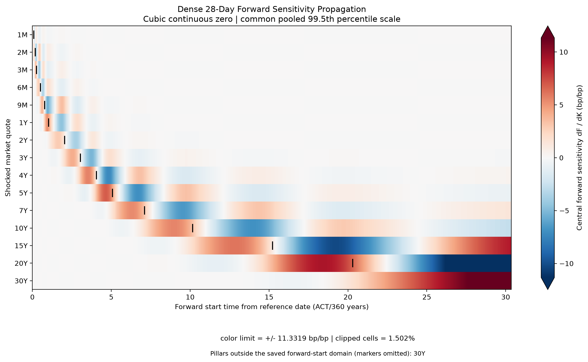
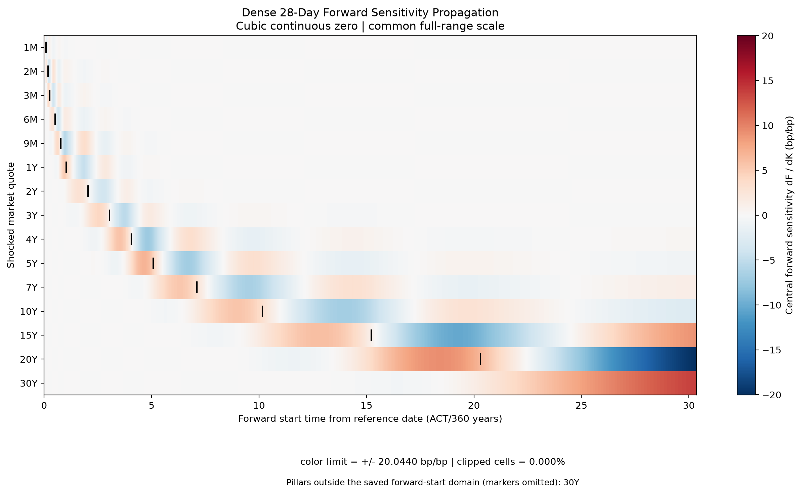
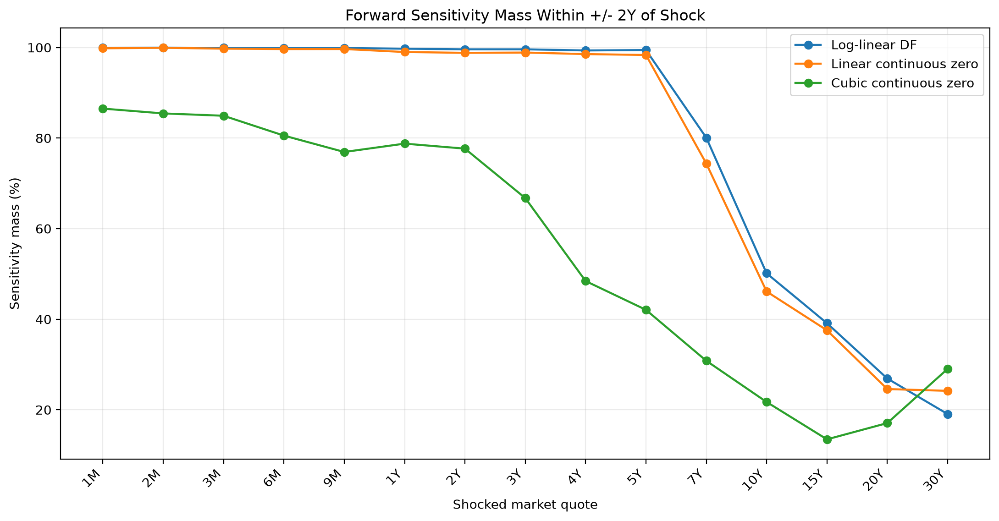

# Quote response, propagation and locality

[Evidence index](index.md) · [Methodology](methodology.md) · [Claims C07–C14](claims-methodology-risk.md) · [Artifact/provenance manifest](../../evidence/c03/methodology-risk-manifest.json)

This C04c package contains **validated research evidence from a synthetic single-curve model**. It measures curve-rate response to quote shocks. No monetary DV01, portfolio P&L, portfolio gamma or hedge effectiveness was demonstrated. The scenario is `FTIIE_KNOWN_TRUTH_V1`, trade date **2026-09-15**, reference date **2026-09-18**, 15 quotes from 1M to 30Y, with projected MXMC 2026–2057 calendar and same-curve projection/discounting. Original source commit is `bee31fd0883660f171ebe84817b98641239eae5b`; original workflow receipts and separate curation time appear in the manifest.

**Presentation review complete:** Human-approved H03/H04 C04c-F01 derivatives resolve FIGURE-01 and are integrated byte for byte by C04c-F02. Their footers are outside the data, and both show the complete 30Y response row. Only the out-of-domain 30Y pillar marker is omitted. Financial matrices and historical originals remain unchanged; the manifest separates original and derivative provenance. Recommendation: `C04C_READY_FOR_PR_REVIEW`.

## A. Section 05: local sequential quote response

Q01–Q05 are **`VALIDATED_RESEARCH_EVIDENCE`**, with no `FROZEN_GOLDEN_REFERENCE` or `OBSERVED_MARKET_EVIDENCE` designation. **No tracked historical Section 05 baseline exists.** Original C03 checks established structural/internal consistency, not historical identity ([C09](claims-methodology-risk.md#c09)).

| Exhibit | Original saved content |
| --- | --- |
| [Q01](../../evidence/c03/section05/one_sided_quote_sensitivity_summary.csv) | 15 one-sided **+1 bp** shocks: own-node DF/zero changes, upstream-invariance check and forward-change summaries |
| [Q02](../../evidence/c03/section05/one_sided_zero_sensitivity_matrix.csv) | 15×15 one-sided node-zero response matrix |
| [Q03](../../evidence/c03/section05/central_quote_sensitivity_summary.csv) | 15 central **±1 bp** shocks: own-node sensitivity/curvature and forward summaries |
| [Q04](../../evidence/c03/section05/central_zero_sensitivity_matrix.csv) | 15×15 central node-zero response matrix |
| [Q05](../../evidence/c03/section05/own_node_local_curvature.csv) | 15 own-node sensitivities/curvatures; deliberate compact duplication of Q03's own-node columns |

Both workflows use **sequential `LOG_LINEAR_DF` bootstrap**. Each quote is shocked alone, holding the other quotes fixed. Matrix **rows are shocked quote tenors**; **columns are responding continuous-zero node tenors**. Both axes follow 1M, 2M, 3M, 6M, 9M, 1Y, 2Y, 3Y, 4Y, 5Y, 7Y, 10Y, 15Y, 20Y, 30Y. The physical CSV has a row-label column in addition to its 15 numerical columns. These are response matrices, not quote covariance matrices.

Let `Z0`, `Z+`, `Z−` be the base, +h and −h **node zero rates measured in zero-rate bp**, and `h=1` be the bump **measured in quote bp** (0.0001 annual decimal quote rate). The estimators are:

```text
D+ = (Z+ - Z0) / h                 [zero bp / quote bp]
Dc = (Z+ - Z−) / (2h)              [zero bp / quote bp]
C  = (Z+ - 2Z0 + Z−) / h²          [zero bp / quote bp squared]
```

The implementation multiplies decimal zero-rate differences by 10,000 before normalizing by quote bp. The local quadratic interpretation is `ΔZ ≈ Dc·δ + 0.5·C·δ²`, with δ in quote bp. This curvature measures a local finite-bump **curve-rate** response, separate from portfolio gamma and from an analytic derivative guarantee.

Q01's `own_node_zero_change_bp` is a **change in bp**, while Q02 divides that change by the bump. Their recorded own-node numbers coincide because h=1; that numerical coincidence is specific to this bump size. Q01's DF changes are dimensionless, and its forward RMSE/max columns measure bp changes. Q03's forward sensitivity summaries are bp/bp and its forward curvature summaries are bp/bp², even where column names omit the unit suffix.

At **30Y**, the saved +1 bp own-node zero change is **2.497681564725407 bp**; central sensitivity is **2.490478975129551 bp/bp**, and local curvature is **0.014405179191712136 bp/bp²** ([C10](claims-methodology-risk.md#c10)). These are different finite-difference estimators. For shared base/plus/minus values, `D+ − Dc = h·C/2` algebraically; the original checker disclosed floating arithmetic residuals up to approximately 1.11e-16. No new tolerance or financial computation was introduced here.

Saved upstream matrix responses are exact zeros, and summary diagonals match their matrices. Earlier nodes remain fixed under this strict sequential calibration structure; this is not a general invariance result for simultaneous calibration. Q01's upstream DF check uses the original 1e-12 threshold. Forward diagnostics use 28-day simple ACT/360 periods on seven-day starts. **Only forward summaries were saved**; Section 05 contains neither full shocked forward series nor a node-curvature matrix. Global outputs below do not become missing Section 05 outputs.

## B. Global simultaneous sensitivity

The global workflow recalibrates **all three methods simultaneously**: `LOG_LINEAR_DF`, `LINEAR_CONTINUOUS_ZERO`, `CUBIC_CONTINUOUS_ZERO`. There are 15 one-factor quote shocks per method, each at ±1 bp: **three base calibrations plus 90 perturbed calibrations**. [G02 base diagnostics](../../evidence/c03/global/global_calibration_diagnostics.csv) records three successful base solves; [G01](../../evidence/c03/global/global_sensitivity_summary.csv) retains **45 method/shock rows**, including plus/minus success and repricing errors. Original checks found all solves successful and repricing within the existing **0.01 bp** policy ([C11](claims-methodology-risk.md#c11)).

This calibration credibility is necessary before interpreting responses; it does not establish latent-truth recovery or independent-vendor valuation. See [fit versus recovery](methodology.md#d-quote-fit-and-known-truth-recovery) and the existing [C04b repricing discussion](valuation.md#d-independent-repricing). G02's elapsed seconds describe the historical run; they are not a benchmark guarantee or financial sensitivity.

| Signed node-zero matrix | Calibration and units |
| --- | --- |
| [G03 log-linear DF](../../evidence/c03/global/node_zero_sensitivity_matrix_log_linear_df.csv) | Simultaneous; zero bp / quote bp |
| [G04 linear continuous zero](../../evidence/c03/global/node_zero_sensitivity_matrix_linear_continuous_zero.csv) | Simultaneous; zero bp / quote bp |
| [G05 cubic continuous zero](../../evidence/c03/global/node_zero_sensitivity_matrix_cubic_continuous_zero.csv) | Simultaneous; zero bp / quote bp |

Each is 15×15: **row = shocked quote, column = responding zero node**. Central estimators have the same dimensional interpretation as above. A positive value indicates an increasing responding rate for an increasing shocked quote locally; a negative value indicates the opposite. Neither sign alone specifies portfolio profit, loss or hedge direction. A zero-rate response per quote bump is a quote-to-curve Jacobian entry, without currency/notional scaling or portfolio exposure.

Coupling depends on the method and tenor. For the cubic **30Y shock**, G05 records **−0.0030348615520647826 bp/bp at the 15Y node**, **+0.012155346760869823 at 20Y**, and **+2.748422664457864 at 30Y**. G01 reports a small nodal off-diagonal share **0.005589592911087502**, while its maximum absolute forward response is **13.82090961601197 bp/bp**, at **2056-08-18**. These describe different response spaces: small node cross-response does not rule out substantial off-node forward response ([C12](claims-methodology-risk.md#c12)).

Read all saved signed entries without rounding small simultaneous responses into structural exact zeros. G01's off-diagonal share normalizes **absolute nodal response**, distinct from forward-distance locality below. G06 is withheld for absolute local output paths; the manifest gives its original hash and an authored summary of engine, shock design, matrix units, grid and historical runtime. **G07 is excluded**: its original non-diverging cubic node palette can obscure signed off-diagonal responses. The signed G05 table remains available.

<a id="c-paired-original-forward-heatmaps"></a>

## C. Paired forward heatmap presentation derivatives

[H01 scale diagnostics](../../evidence/c03/heatmaps/forward_sensitivity_heatmap_scale_diagnostics.csv) contains three method rows and one pooled row. H02 is withheld for local input/output paths; its original identity and a summary of axes and color-scale metadata are in the manifest. The dense global producer saved **70,290** forward response rows: 3 methods × 15 shocks × **1,562 starts**. The starts run from **2026-09-18 through 2056-08-18**, every seven days; 28-day forward ends run through **2056-09-15**. This differs from the recovery workflows' terminal-start handling.

In H03/H04, **rows are shocked synthetic quote tenors**, **columns are forward start time in ACT/360 years**, and the response is the central **28-day simple forward sensitivity in bp/bp**. Red means positive response and blue negative, centered at zero. **Black ticks mark in-domain shocked-quote payment pillars**, not additional rate observations. A white-looking cell is not proof of exact zero. The 30Y pillar at **2056-09-20** lies **33 days beyond** the final saved forward start, **2056-08-18**: only that marker is omitted, with no clamping or artificial boundary marker. The complete 30Y response row remains visible across the saved domain; fourteen valid markers remain.

| Presentation derivative | Symmetric common cap (bp/bp) | Clipping |
| --- | ---: | --- |
| H03 robust, pooled absolute 99.5th percentile | ±11.33194135019177 | **1.5023474178403756% of cubic cells**, approximately **1.5023474%**; pooled clipped fraction 0.005007824726134585 |
| H04 full range across all methods | ±20.04398642012309 | **0% of cells** |

A saturated H03 color gives a bound at the scale cap, **not the exact underlying sensitivity**. H04 restores the full range, compressing the visual contrast of smaller responses. Compare colors only with their stated caps; the same hue in the robust and full panels need not indicate the same value. H01 includes all methods even though this selected pair shows cubic only ([C13](claims-methodology-risk.md#c13)).





**H03 + H04 — Human-approved paired presentation derivatives, `PRESENTATION_DERIVATIVE_FROM_VALIDATED_DATA`.** Synthetic `FTIIE_KNOWN_TRUTH_V1`, simultaneous cubic ±1 bp quote shocks; projected MXMC 2026–2057; trade/reference dates 2026-09-15/2026-09-18; historical C03b2a workflow `heatmaps`. Rows: quote tenors; x: 28D forward start ACT/360 years; colors: signed central forward bp per quote bp; black ticks: in-domain shock pillars. Robust clipping is approximately **1.5023474%** of cubic cells; full-range clipping is **0%**. Both footers sit outside the data. The complete 30Y response row is visible; its out-of-domain payment-pillar marker alone is omitted. C04c-F01 changed rendering layout and valid marker placement using unchanged saved matrices; C04c-F02 copies the approved PNGs without re-rendering. Historical image hashes and financial execution provenance remain distinct from public derivative hashes and rendering source/environment in the manifest. No new financial calculation occurred.

## D. Locality and the 30Y counterexample

[L01 locality table](../../evidence/c03/locality/forward_sensitivity_locality.csv) contains **45 method/shock rows** on the same 1,562-start forward grid. L02's local source/output paths prevent copying it unchanged; its manifest summary preserves the metric definitions and original identity. Let `s_j` be the signed central forward response at start time `t_j`, and `T_shock` the payment-pillar time, all times in ACT/360 years:

```text
w_j = |s_j| / sum_k |s_k|
mass within ±a years = sum of w_j where |t_j - T_shock| <= a
RMS distance = sqrt(sum_j w_j * (t_j - T_shock)^2)
```

Absolute sensitivity mass measures where sampled response magnitude lies. Normalization removes total magnitude and **discards signs**; positive and negative responses that could cancel in a signed sum both add to absolute mass. The weights sum to one by construction, with no probability interpretation. L01 also preserves weighted center, center offset, weighted spread and ±1Y/±2Y mass; CSV mass is a fraction and the plot uses percent. Locality is neither monetary portfolio risk nor hedging effectiveness.



**L03 — Synthetic simultaneous ±1 bp study, all three methods; original C03b2a workflow `locality`.** Projected MXMC 2026–2057; trade/reference dates 2026-09-15/2026-09-18. Vertical axis: percentage of normalized absolute central 28D-forward sensitivity within ±2 ACT/360 years of the shock pillar. **Horizontal positions are equally spaced tenor categories, not a continuous maturity scale.** Lines connect categories; their spacing and slopes do not measure maturity distances. Original output/source hashes and execution times are in the manifest. Dense source remains external.

Propagation changes with tenor and with the metric. At **30Y**, ±2Y absolute mass is **0.19051544785211189** for log-linear DF, **0.2417759345236683** for linear continuous zero, and **0.29034212262038983** for cubic. Cubic is above both challengers there: **“cubic is always less local” is contradicted by the saved study** ([C14](claims-methodology-risk.md#c14)). The sampled forward-start domain ends before the 30Y pillar, leaving no symmetric post-pillar tail; normalized masses and distances reflect this finite-domain boundary. The result does not establish how an extended domain would behave.

## E. Preservation and reproduction boundary

The manifest distinguishes historical financial execution, original artifact identity, authored C04c curation, rendering provenance and the current documentation base commit. The selected set retains **23 candidates / 700,982 original bytes**. Distribution is **17 byte-identical originals / 393,888 bytes**, **two approved presentation derivatives / 297,723 bytes**, and **four withheld original metadata files / 13,777 bytes** (M04, G06, H02, L02): **19 distributed exhibits / 691,611 bytes**, four withheld. These are distribution counts, not additional financial datasets. All historical originals remain external and unchanged. Exact JSON field findings are identified without publishing private path values. Summary fields are authored provenance descriptions, not altered originals. C04b exhibits, C01–C06 and frozen references are unchanged.

This is **not the complete global replay archive** of 49 files / 16,847,372 bytes. Saved-data consumers require **both** `global_forward_sensitivity_dense.csv` (13,313,113 bytes) and `global_node_sensitivity_long.csv` (84,886 bytes), at `tables/07_global_sensitivity/` under the same expected reports root. Their original evidence identities and SHA-256 are recorded in the manifest; neither file is distributed here. A command recipe cannot make these inputs available. Original audit receipts are also external, with no public download claimed.

The original global producer took **4,802.487169651984 seconds, approximately 80 minutes**. It was not rerun. C04c-F01 ran the plotting consumer once from verified persisted inputs for all three methods and both scales; C04c-F02 reused that evidence without new renders. No financial pytest suite, calibration or numerical sensitivity producer was executed. Public figures are observable evidence, while full research replay still requires the external dense data and recorded source/environment. Any separately authorized reproduction needs verified inputs and new output/temporary/cache roots. Durable dense-data distribution and a fuller reproduction appendix are **deferred to C04d**. No observed-market, multi-curve, portfolio-P&L, hedge-effectiveness or production-readiness claim follows from this package.
