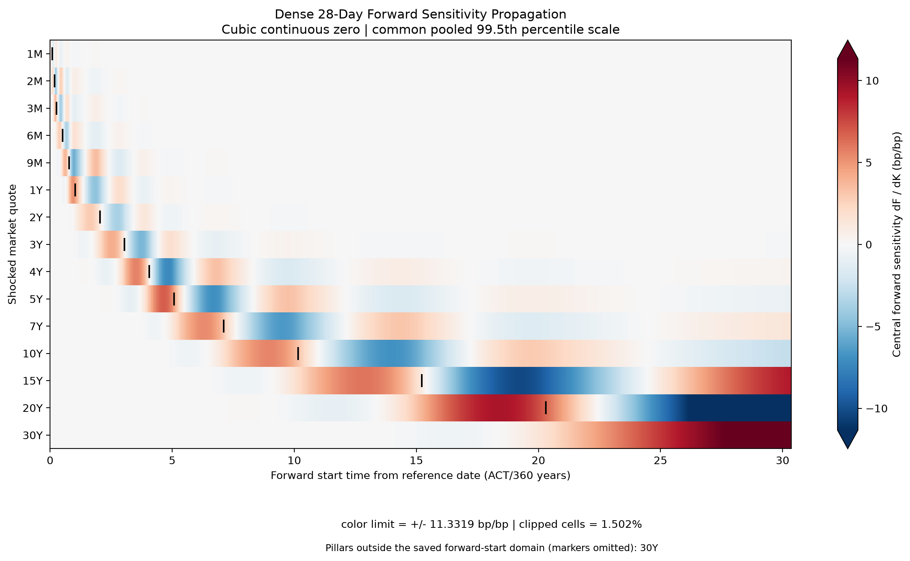
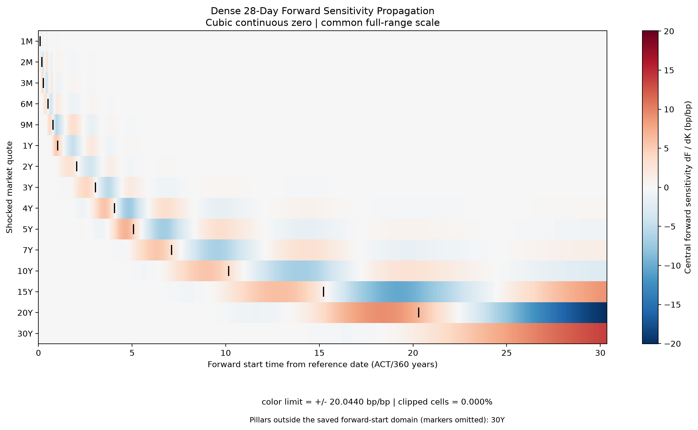
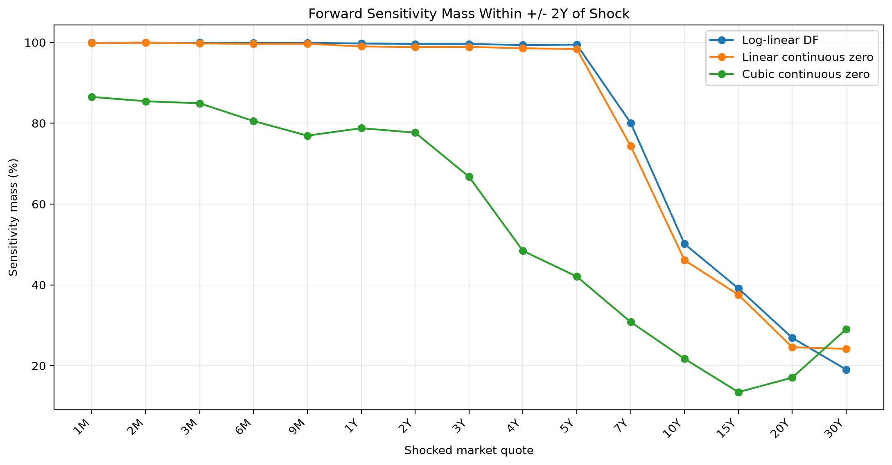

# Quote Sensitivity, Forward-Rate Propagation and Locality

This study examines **how changes in individual F-TIIE OIS par quotations affect the calibrated term structure**. The risk question is not just how much a discount-factor node moves: interpolation can transmit a shock into **forward rates away from the quoted maturity**, with consequences for how curve risk is interpreted.

The experiments use **15 synthetic OIS quotations (1M–30Y)**, a **projected MXMC calendar for 2026–2057**, and **single-curve projection and discounting**. The measurements are **quote-to-curve-rate sensitivities**, not monetary DV01, portfolio gamma, trading P&L or demonstrated hedge effectiveness.

[Evidence overview](index.md) · [Methodology and recovery](methodology.md) · [Detailed sensitivity claims](claims-methodology-risk.md) · [Source and presentation manifest](../../evidence/c03/methodology-risk-manifest.json)

## A. Local responses under sequential bootstrapping

First, the project constructs a curve using **sequential bootstrapping with log-linear discount-factor interpolation**. It perturbs each of the 15 synthetic par quotations individually, while keeping all others unchanged.

Two finite-difference designs are recorded:

| Experiment | Saved evidence |
|---|---|
| **One-sided +1 bp shocks** | [Summary](../../evidence/c03/section05/one_sided_quote_sensitivity_summary.csv) · [Node zero-rate matrix](../../evidence/c03/section05/one_sided_zero_sensitivity_matrix.csv) |
| **Symmetric ±1 bp shocks** | [Central sensitivity summary](../../evidence/c03/section05/central_quote_sensitivity_summary.csv) · [Node zero-rate matrix](../../evidence/c03/section05/central_zero_sensitivity_matrix.csv) · [Own-node curvature](../../evidence/c03/section05/own_node_local_curvature.csv) |

In each 15×15 matrix, **rows identify the shocked quote tenor** and **columns identify responding continuous-zero-rate node tenors**. These are **response matrices**, not covariance or correlation matrices.

Let $Z_0$, $Z_+$ and $Z_-$ be the base, positively shocked and negatively shocked **zero rates in bp**, and let $h=1$ denote the size of the quote bump **in bp**. The saved estimators are

$$
D_+=\frac{Z_+-Z_0}{h},
\qquad
D_{\mathrm{c}}=\frac{Z_+-Z_-}{2h},
$$

$$
C=\frac{Z_+-2Z_0+Z_-}{h^2}.
$$

Thus $D_+$ and $D_{\mathrm{c}}$ have units of **zero-rate bp per quote bp**, while $C$ is measured in **zero-rate bp per squared quote bp**. For a small quote perturbation $\delta$ in bp, the local quadratic interpretation is

$$
\Delta Z \approx D_{\mathrm{c}}\,\delta+\frac12 C\,\delta^2.
$$

This is **finite-bump curve-rate curvature**, not portfolio option gamma.

At **30Y**, the saved results give:

| Measurement | Result |
|---|---:|
| +1 bp own-node zero-rate change | **2.497681564725407 bp** |
| Central own-node sensitivity | **2.490478975129551 bp/bp** |
| Own-node finite-difference curvature | **0.014405179191712136 bp/bp²** |

One-sided changes and normalized sensitivities happen to share numerical values for a **1 bp bump** in some columns; that does not make their units interchangeable.

The saved sequential matrices record **exactly zero upstream node responses**, consistent with earlier nodes being frozen in the strict sequential construction. This does **not** imply that upstream nodes are invariant under **simultaneous calibration**.

The local sequential study saves forward **summaries**, not every shocked forward time series. Its structural validations are not an external benchmark or a stored reference establishing broader market validity.

## B. Global sensitivity under simultaneous calibration

The second study holds the **simultaneous nodal calibration engine** fixed and evaluates three interpolation representations:

1. Log-linear discount factors.
2. Linear interpolation of continuously compounded zero rates.
3. Natural cubic interpolation of continuously compounded zero rates.

For each method, 15 quotations are independently shocked by **+1 bp and −1 bp**, producing **three base calibrations plus 90 shocked calibrations**. [Saved calibration diagnostics](../../evidence/c03/global/global_calibration_diagnostics.csv) and the [45-row global summary](../../evidence/c03/global/global_sensitivity_summary.csv) report successful solves and quote repricing within the existing **0.01 bp** standard.

The resulting **central signed node sensitivities** are available for each method:

| Method | 15×15 node response matrix |
|---|---|
| Log-linear discount factors | [View CSV](../../evidence/c03/global/node_zero_sensitivity_matrix_log_linear_df.csv) |
| Linear continuous zero rates | [View CSV](../../evidence/c03/global/node_zero_sensitivity_matrix_linear_continuous_zero.csv) |
| Natural cubic continuous zero rates | [View CSV](../../evidence/c03/global/node_zero_sensitivity_matrix_cubic_continuous_zero.csv) |

Each entry represents a **zero-rate change in bp per 1 bp change of the input par quotation**. Signs indicate the direction of the local rate response; they **do not determine the P&L sign of an unspecified portfolio**.

### Why node sensitivities are not the entire story

For a **30Y quotation shock** under natural cubic interpolation, the saved node response includes:

| Responding zero-rate node | Central response (bp/bp) |
|---|---:|
| 15Y | −0.0030348615520647826 |
| 20Y | +0.012155346760869823 |
| 30Y | +2.748422664457864 |

The saved summary reports a small off-diagonal **absolute node-response share** of **0.005589592911087502** for this shock, yet the maximum absolute **28-day forward-rate response** reaches **13.82090961601197 bp/bp**, at **18 August 2056**.

These quantities measure **different objects**. A curve can have modest cross-node zero-rate movements while displaying substantial between-node forward sensitivity. Small signed responses should not be rounded to structural zeros.

## C. Paired forward heatmap presentation derivatives

The saved global study evaluates central 28-day forward sensitivities on **1,562 seven-day start dates**, spanning **18 September 2026 to 18 August 2056**, for 15 shocked tenors and three interpolation methods: **70,290 forward-response observations**.

In the heatmaps below, **rows are shocked OIS maturities** and **columns are forward-start times in ACT/360 years**. Color shows signed forward-rate sensitivity in **bp/bp** (red positive, blue negative). Black tick marks identify **in-domain payment pillars** associated with the shocked OIS tenors; they are not additional rate observations.

Two versions of the **same saved cubic sensitivity matrix** are provided because the range of responses affects readability.

| Figure | Common symmetric color scale | Clipped cubic cells |
|---|---:|---:|
| **Robust view** — pooled 99.5th-percentile cap | ±11.33194135019177 bp/bp | **1.5023474%** |
| **Full-range view** — largest absolute response | ±20.04398642012309 bp/bp | **0%** |

The robust figure emphasizes moderate responses but **clips the color**, not the data. Saturated colors signify values at least as extreme as the cap, not an exact numerical value. The full-range view preserves all amplitudes but can make smaller effects harder to distinguish. A pale cell is not proof of an exactly zero response.

*Robust common color scale; approximately 1.5023474% of cubic cells exceed the plotted cap.*

*Full common color scale; no clipped cells. [Exact scale statistics](../../evidence/c03/heatmaps/forward_sensitivity_heatmap_scale_diagnostics.csv).*

Both are **reviewed presentation derivatives of unchanged validated numerical matrices**, not newly recalibrated curves. Text/footers appear outside the data region; the **complete 30Y sensitivity row** remains visible.

The **30Y payment pillar (20 September 2056)** lies **33 days beyond the final displayed forward start (18 August 2056)**. Its black marker is correctly omitted rather than moved into the displayed domain; the other fourteen valid markers remain.

## D. Locality and the 30Y counterexample

A quote response can extend across the curve, but *how local* it is depends on the measured object and on the maturity of the shock. To compare forward-response locations, the study normalizes the **absolute central forward sensitivity** on the saved finite grid.

Let $s_j$ be the signed central 28-day forward response at start time $t_j$, and let $T_{\mathrm{shock}}$ denote the maturity of the shocked OIS payment pillar, all expressed in ACT/360 years. The normalized weights and locality measures are

$$
w_j=\frac{|s_j|}{\sum_k |s_k|},
\qquad
\sum_j w_j=1,
$$

$$
M(a)=\sum_{|t_j-T_{\mathrm{shock}}|\leq a} w_j,
\qquad
d_{\mathrm{RMS}}=
\sqrt{\sum_j w_j (t_j-T_{\mathrm{shock}})^2}.
$$

Here $M(a)$ measures the **fraction of total absolute sensitivity mass** lying within ±$a$ years of the shocked pillar. These are **not probabilities**, and the absolute-value normalization intentionally discards sign and overall magnitude. The measures describe locality within the **finite observed forward-start grid** only.

*All three interpolation methods, simultaneous calibration, ±1 bp quote shocks. The horizontal tenors are **equally spaced categories**, not a continuous maturity axis; line slopes do not measure calendar-time distances.*

The saved [locality table](../../evidence/c03/locality/forward_sensitivity_locality.csv) contains 45 method/shock rows. For the **30Y** shock, the proportion of absolute response within ±2 years is:

| Interpolation | 30Y locality mass within ±2Y |
|---|---:|
| Log-linear discount factors | 19.0515% |
| Linear continuous zero rates | 24.1776% |
| Natural cubic continuous zero rates | **29.0342%** |

This is a direct **counterexample to the assertion that cubic interpolation is always less local**: here, cubic has a **greater** fraction of absolute forward-response mass near the 30Y shock pillar.

The result is limited by the grid. The final forward start is **before** the 30Y payment pillar, leaving no symmetric post-pillar tail. The reported shares do **not** determine how the methods would rank on a longer or differently sampled forward domain.

## E. Preservation and reproduction boundary

The public methodology/risk evidence distributes **19 exhibits**—17 byte-identical original files and **two reviewed visual derivatives**—from a 23-candidate selection. Four original metadata files containing machine-specific absolute paths remain outside the repository; their original hashes and limited descriptions are preserved in the [manifest](../../evidence/c03/methodology-risk-manifest.json). No original financial matrix is changed by the presentation derivatives.

The larger original global study contains additional materials, including dense forward and node-response CSVs. The [saved-data transport manifest](../../evidence/c03/replay-inputs.json) binds **two verified compressed computational inputs** that can be extracted for a limited heatmap/locality replay. These assets are **dependencies**, not additional claimed public financial exhibits.

The recorded saved-data replay executed the two consumer workflows, matched the retained scale/locality references, and did **not** rerun the expensive global calibration producer. Original financial computation, figure rendering, saved-data replay and public selection are different activities. [Reproduction instructions](reproduce.md) document their scopes and numerical environment.

All results are scenario-specific. They establish **curve-rate responses under controlled synthetic input shocks**, not monetary DV01, portfolio delta/gamma, hedging effectiveness, observed-market volatility, collateral-specific multicurve behavior or production readiness. A smooth generating curve and a finite maturity domain constrain the conclusions.
