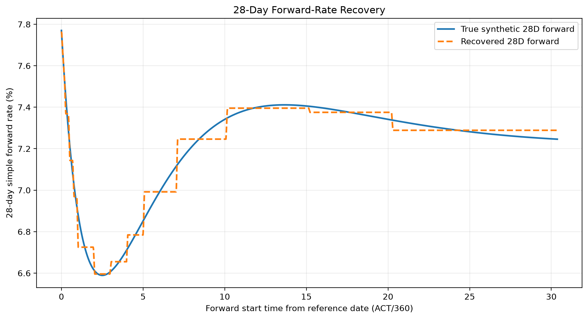

# Valuation and assurance evidence

[Evidence index](index.md) · [Claims C01–C06](claims-valuation.md) · [Provenance manifest](../../evidence/c03/valuation-manifest.json)

**Review status:** C04b subset; snapshot publication `BLOCKED_PENDING_REVIEW`. Eleven original exhibits are included, including standalone original payloads S03/S05/S06. The complete accepted snapshot remains unchanged and externally archived; S01/S02/S04/S07 and original audit records are not distributed. Results below describe C03 computations; C04b ran no financial computation, repricing or assurance CLI.

## A. Financial problem and Core-v1 scope

The project constructs a synthetic MXN F-TIIE OIS curve and asks whether it fits its calibration instruments, satisfies explicit project acceptance rules and preserves an auditable valuation state. Core-v1 uses one curve for both projection and discounting. This assumption does not demonstrate an institutional multi-curve architecture. The sequential benchmark and simultaneous cubic baseline answer related questions with different calibration engines.

## B. Synthetic financial inputs

`FTIIE_KNOWN_TRUTH_V1` supplies **15 synthetic quotes**, from 1M to 30Y. Trade date is **2026-09-15**; the common effective date and curve reference date are **2026-09-18**. The existing [frozen quote source](../../data/synthetic/ftiie_ois_quotes_v1.csv) has SHA-256 `38469f91b95ad5afad4a593a39c791a49e34ca435fc461f88d3b2039b717a5e6`. Its source format differs from [S03: the 15 normalized synthetic calibration inputs](../../evidence/c03/valuation/input_quotes.csv), now public as an unchanged standalone exhibit.

[I01: supplied holiday CSV](../../evidence/c03/inputs/projected_mxmc_2026_2057.csv) preserves the projected MXMC model input, with declared coverage **2026-01-01 through 2057-12-31**. The original serialized calendar S04 records `PROVIDED` provenance: supplied projected-model bytes, with no official future-calendar status. The original demo/explicit-input comparison found identical financial input, node and repricing rows; metadata/provenance identity was different ([C04](claims-valuation.md#c04)). The comparison record remains external.

Rates are annual decimals unless labeled otherwise. Columns named `market_quote` in the research CSVs are synthetic calibration observations, never observed market prices.

## C. Calibration

The accepted original baseline is `FTIIE_CUBIC_SIMULTANEOUS_V1`: simultaneous nodal least squares with **`CUBIC_CONTINUOUS_ZERO`**, natural spline boundaries and 15 discount-factor nodes. [S05: all 15 calibrated nodes](../../evidence/c03/valuation/curve_nodes.csv) are public as an unchanged standalone exhibit. Continuous zero rates satisfy `z(t) = -ln(P(t))/tau`, using ACT/360 time. Automatic extrapolation is disabled; each pillar is the instrument's final payment date.

The captured Core-v1 policy uses T+2 MXMC business-day effectiveness, ACT/360 accrual, 28-day payment/calculation/reset periods, FOLLOWING date adjustments and a two-business-day payment lag. Overnight fixing uses zero business-day offset and PRECEDING adjustment; compounding is `ISDA_STANDARD`, spread exclusive, with zero spread and unit calibration notional. See existing [conventions](../conventions.md) and [methodology](../methodology.md); the archived cubic policy governs this baseline, while historical sequential interpolation is described separately.

Solver success establishes numerical termination. Financial acceptance additionally requires structural validity and independent instrument repricing under `FTIIE_STANDARD_BASELINE_ACCEPTANCE_V1`. Original S07 records `calibration_success=true`, `structural_valid=true` and `accepted_for_use=true`. These are separate assertions ([C01](claims-valuation.md#c01)); none was recomputed during curation.

## D. Independent repricing

Original S06/S07 record **15 independent PASS results**, with maximum absolute par-rate error **4.3853809472693683e-11 bp**, against the standard **0.01 bp PASS tolerance** (FAIL threshold 0.1 bp). The repricer reconstructs instruments and recomputes par rates independently of solver residuals **inside the same codebase**. This is no independent-vendor valuation opinion.

[S06: all 15 independent repricing observations](../../evidence/c03/valuation/quote_repricing.csv) are public as an unchanged standalone exhibit, with 15 saved PASS statuses. [C01](claims-valuation.md#c01) identifies the original hash and the external acceptance-metadata boundary. Public B02 below is the separate sequential benchmark, and cannot substitute for cubic S06.

## E. Accepted snapshot

The original CLI locally published run **`ab8b26ab993140dca7dcbd7491c3a8c0`**, schema **3.0**, created at **2026-11-04T18:58:20.039772+00:00**. S01 `current.json` points to its relative run directory and binds S02 `manifest.json` by SHA-256. The manifest binds five payloads: S03 inputs, S04 calendar, S05 nodes, S06 repricing and S07 metadata. Original `accepted_for_use=true` remains unchanged ([C02](claims-valuation.md#c02)). Acceptance concerns this synthetic scenario under project policy, with no public-market certification.

**Complete snapshot archive publication remains `BLOCKED_PENDING_REVIEW`.** S07 contains two absolute local paths at JSON pointers `/execution/quote_provenance/path` and `/quote_provenance/path`. The original accepted seven-file archive remains complete, unchanged and externally archived. Under the approved C04b-F01 distribution policy, S03/S05/S06 are separate, byte-identical original payload exhibits; S01/S02/S04/S07 are not distributed. These exhibits are not a partial snapshot archive, cannot be passed to snapshot assurance and create no replacement run identity. Static pointer/manifest/five-payload closure passed **on the original external source only**. The snapshot's acceptance and execution bindings are not fully independently inspectable from the public collection.

## F. Subsequent assurance

Original C03b1 build, subsequent rebuild assurance and subsequent snapshot assurance each exited 0. The rebuild recalibrated the explicit inputs; snapshot mode reconstructed saved nodes without calibration. Original before/after receipts record exact snapshot identity across inventory, sizes, SHA-256, pointer bytes, modes and file modification times ([C03](claims-valuation.md#c03)).

**No new assurance was executed in C04b.** Original receipts/logs remain in external audit evidence, identified by checkpoint and hash on the claims page and manifest. A public reader can inspect the eleven copied exhibits and compact provenance, including instrument-level cubic input/node/repricing rows. The complete original cubic archive, acceptance metadata, execution bindings and assurance logs remain external; the public exhibits do not independently establish original assurance. Hashes establish consistency, with no authentication or trusted-timestamp guarantee.

## G. Sequential bootstrap benchmark

The separate **`LOG_LINEAR_DF`** benchmark solves each terminal node sequentially with prior nodes fixed. [B01 validation summary](../../evidence/c03/bootstrap/curve_validation_summary.csv) records **`VALID`**, 15 quotes, 15 nodes, 15 converged steps, **15 independent PASS checks** and **zero critical issues**. Saved maximum repricing error is **4.170969125638635e-09 bp**. [B02](../../evidence/c03/bootstrap/independent_repricing.csv) contains instrument-level checks. [B03](../../evidence/c03/bootstrap/validation_issues.csv) intentionally retains its header with zero issue rows ([C05](claims-valuation.md#c05)). This historical validation contract is distinct from the cubic operational acceptance policy.

## H. Fit versus known-truth recovery

Fitting 15 par quotes constrains instrument values; it does not identify the latent curve at every point between pillars. Known truth is introduced after calibration for comparison. [B04 node recovery](../../evidence/c03/bootstrap/bootstrap_node_recovery.csv) records 30Y DF difference **-4.418431951883073e-05**. [B05 global metrics](../../evidence/c03/bootstrap/recovery_metrics_global.csv) records 28-day forward RMSE **3.8110099310701564 bp** across **1,563** forward observations. [B06 horizon metrics](../../evidence/c03/bootstrap/recovery_metrics_by_horizon.csv) separates 0–1Y, 1–5Y, 5–10Y and 10Y–curve-end; retain each metric's saved observation count.

**B07 — Synthetic sequential LOG_LINEAR_DF; 28-day simple ACT/360 forward, weekly starts; curve recovery is separate from quote repricing. Dense source remains external.** Scenario `FTIIE_KNOWN_TRUTH_V1`, trade/reference dates 2026-09-15/2026-09-18, projected MXMC 2026–2057; original workflow `plot_bootstrap_recovery`, C03b2b. Horizontal axis: forward start time from reference in ACT/360 years. Vertical axis: annual simple forward percent. Original source/output hashes and execution times are in the manifest.

The diagnostic is `F(T1,T2) = (P(T1)/P(T2) - 1) / ACT360(T1,T2)` for a 28-day period. Plot and metrics workflows use seven-day sampling but distinct terminal-start handling; do not require identical grids or transplant values across workflows. The zero-rate plot in the broader archive starts at reference+1 day and is not included here. DF differences are dimensionless, relative DF errors are ppm, and zero/forward errors are bp; figure levels use percent. These approximation errors describe recovery and interpolation, **without reversing operational acceptance** ([C06](claims-valuation.md#c06)).

## I. Limitations and next evidence layers

The recorded reference environment is **Python 3.11.15, NumPy 2.4.6, SciPy 1.17.1, Matplotlib 3.11.2 and yield-curves 0.1.0**, at source commit **`bee31fd0883660f171ebe84817b98641239eae5b`**. Environment receipts remain external. C04b's curation time is separate from original workflow timestamps in the manifest.

Original curve computation, independent repricing, snapshot/rebuild assurance, synthetic known-truth comparison and C04b byte copying are distinct activities. Historical comparison scope is per artifact in the manifest; no cross-platform or dependency-version bitwise guarantee follows. This subset is insufficient for complete research replay: dense figure inputs and original audits remain external, and the complete snapshot archive is withheld. Any separately authorized reproduction must use the recorded source and reference environment, verified inputs and **new external output, temporary and cache roots**, leaving original checkpoints preserved. No executable financial rerun recipe is supplied here.

Broader interpolation and sensitivity evidence layers remain deferred. Observed-market validation, verified future calendars, multi-curve discounting and production deployment require separate evidence and review.
