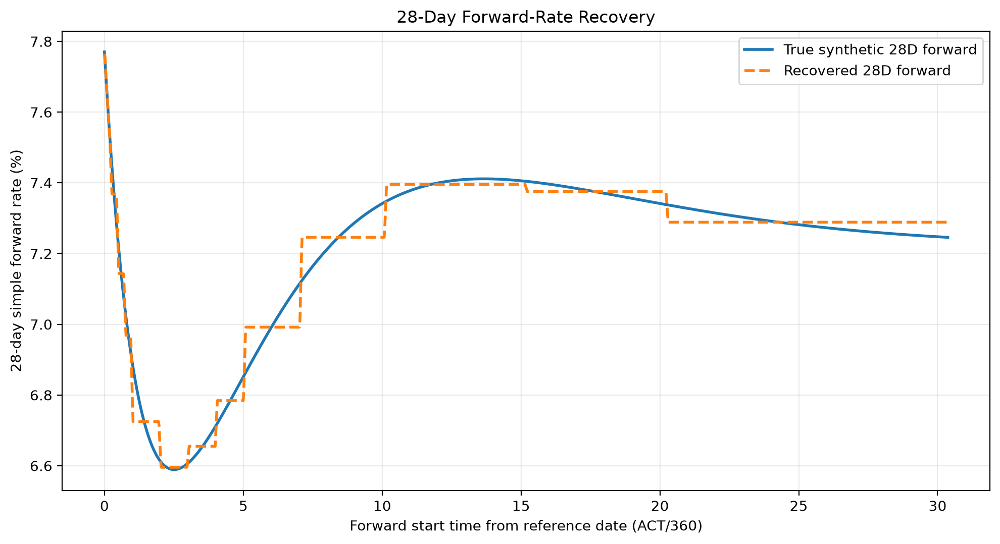

# Valuation, Repricing and Acceptance Evidence

This study examines whether the implemented MXN F-TIIE OIS curve construction **reproduces the par quotations used for calibration**, whether the resulting curve satisfies the project's defined acceptance criteria, and what can be learned about recovery of the underlying synthetic term structure.

The numerical results were produced in an earlier recorded financial execution. This document **interprets saved evidence**; it does not claim to have recalibrated or independently rerun that execution.

[Evidence overview](index.md) · [Exact valuation claims and provenance](claims-valuation.md) · [Original artifact manifest](../../evidence/c03/valuation-manifest.json)

## A. Financial question and assumptions

A curve built from swap par quotations must reproduce the pricing implications of each input instrument. However, **instrument repricing and recovery of an unobserved term structure are separate tests**.

The project constructs F-TIIE OIS cash flows using MXN settlement/calendar rules, ACT/360 and compounded overnight payments. The current model uses **one curve for both overnight projection and discounting**, an explicit simplification rather than a full collateral-specific multi-curve model.

The saved evidence covers two implemented construction approaches: **simultaneous calibration with a natural cubic interpolation of continuously compounded zero rates**, the selected baseline, and **sequential bootstrapping with log-linear discount-factor interpolation** as a separate method comparison.

[Instrument conventions](../conventions.md) · [Construction methodology](../methodology.md)

## B. Synthetic financial inputs

The experiment starts with **15 synthetic F-TIIE OIS par quotations**, spanning 1M to 30Y, generated from a smooth reference term structure. Its trade date is **15 September 2026**, and its common effective/curve reference date is **18 September 2026**.

The original frozen [synthetic quote file](../../data/synthetic/ftiie_ois_quotes_v1.csv) is distinct from the [normalized inputs archived for the baseline execution](../../evidence/c03/valuation/input_quotes.csv). The original frozen file's SHA-256 is `38469f91b95ad5afad4a593a39c791a49e34ca435fc461f88d3b2039b717a5e6`.

The [projected MXMC calendar supplied to the original execution](../../evidence/c03/inputs/projected_mxmc_2026_2057.csv) covers **1 January 2026 through 31 December 2057**. This is **not a verified official future holiday calendar**. Original serialized calendar provenance records the supplied projected-model bytes; it does not certify the dates.

Rates labeled `market_quote` in saved reports remain **synthetic calibration observations**, not observed market rates. The synthetic generating curve is used **after calibration** to evaluate recovery.

## C. Simultaneous baseline calibration

The selected baseline jointly calibrates 15 nodal discount factors to the synthetic OIS par rates, using **natural cubic interpolation of continuously compounded zero rates**.

For ACT/360 time $t$ from the effective reference date:

$$
z(t)=-\frac{\ln P(t)}{t},
\qquad
P(t)=e^{-t z(t)}.
$$

The model's calibration pillars are the **final payment dates** of the OIS instruments, and extrapolation beyond the last pillar is disabled. [Calibrated discount factors and zero rates](../../evidence/c03/valuation/curve_nodes.csv) are available as original saved rows.

The recorded solver completed successfully. That result alone is **not acceptance**: the standard baseline must also pass the defined structural conditions and independent instrument repricing checks. Its supported acceptance policy is `FTIIE_STANDARD_BASELINE_ACCEPTANCE_V1`.

## D. Independent repricing

The recorded baseline provides **15 PASS results** when the final curve is used to reconstruct and reprice the 15 synthetic OIS instruments. The maximum absolute repricing discrepancy is **4.3853809472693683 × 10⁻¹¹ bp**, versus the standard **0.01 bp PASS tolerance**.

[Inspect all 15 independent repricing observations](../../evidence/c03/valuation/quote_repricing.csv).

The independent calculation reconstructs the instruments and recalculates their par rates **without relying on the optimizer's saved residuals**. This is independence *within the same implementation*, not a second vendor model or an independent market-pricing opinion.

[Validation and acceptance contract](../validation.md) · [Recorded valuation claim](claims-valuation.md#c01)

## E. Accepted snapshot and public-data boundary

The original workflow recorded an **accepted schema-3.0 execution**, with run identifier `ab8b26ab993140dca7dcbd7491c3a8c0`. Its recorded acceptance fields indicate successful calibration, valid structure and acceptance for use under the project's specified policy.

The run originally comprised a `current.json` pointer, a `manifest.json`, and five bound payload files: input quotes, calendar, curve nodes, quote repricing and execution metadata.

**The complete accepted snapshot is not publicly distributed.** Original metadata contain two machine-specific absolute paths. The unchanged original seven-file archive remains externally preserved; only **three standalone original payloads**—quotes, nodes and repricing—are published here.

Those three files are **not an executable partial snapshot**. They cannot be used as input to the standard persisted-snapshot assurance workflow, and they do not publicly expose the complete original acceptance/execution binding. The original manifest and [claim register](claims-valuation.md#c02) preserve identities and the disclosure limitation.

## F. Rebuild and persisted-snapshot assurance

The recorded execution was followed by two distinct assessments:

- **Rebuild assurance** recalibrated from explicitly supplied financial inputs.
- **Snapshot assurance** reconstructed the archived curve nodes and independently repriced instruments **without rerunning the optimizer**.

The original records report successful completion of the build, rebuild assessment and snapshot assessment, with matching before/after snapshot inventory and integrity receipts. **Those receipts and the complete archive remain external**; no new assurance is claimed from publication of these narrative documents.

Public payload checks allow inspection of saved quotes, curve nodes and repricing results, but cannot independently establish the whole original archive's acceptance history.

[Snapshot semantics](../snapshots.md) · [Original assurance claims](claims-valuation.md#c03)

## G. Sequential calibration comparison

The project also implements **sequential bootstrapping with log-linear discount-factor interpolation**. It solves the next node while retaining previously calibrated nodes and is a valid construction method in its supported setting, not merely a superseded internal baseline.

The saved [sequential validation summary](../../evidence/c03/bootstrap/curve_validation_summary.csv) reports **15 calibrated nodes, 15 converged steps, 15 independent PASS results, zero critical issues**, and maximum absolute repricing error of **4.170969125638635 × 10⁻⁹ bp**.

[Instrument-level checks](../../evidence/c03/bootstrap/independent_repricing.csv) · [Recorded issues (no issue rows)](../../evidence/c03/bootstrap/validation_issues.csv).

These sequential checks and the simultaneous baseline use **different overall validation contracts**. The sequential results should not be represented as proof that a separate cubic baseline execution was accepted.

## H. Fit versus known-truth recovery

Matching OIS par quotations does not determine a unique forward curve between maturity pillars. The synthetic generating curve provides an independent reference *for this controlled scenario*.

The saved sequential log-linear study records:

| Recovery measure | Saved result |
|---|---:|
| 30Y discount-factor difference | −0.00004418431951883073 |
| Dense 28-day forward RMSE | **3.8110099310701564 bp** |
| Forward periods in this recovery grid | **1,563** |

[Node recovery](../../evidence/c03/bootstrap/bootstrap_node_recovery.csv) · [Global recovery metrics](../../evidence/c03/bootstrap/recovery_metrics_global.csv) · [Recovery by horizon](../../evidence/c03/bootstrap/recovery_metrics_by_horizon.csv)

*Sequential log-linear interpolation, seven-day sampled starts, 28-calendar-day simple ACT/360 forward rates. The horizontal axis is forward-start time in ACT/360 years; the vertical axis is annual forward percent. The generating reference curve is used only for the recovery comparison.*

The rate over dates $T_1$ and $T_2$ is

$$
F(T_1,T_2)=
\frac{P(T_1)/P(T_2)-1}{\tau_{\mathrm{ACT/360}}(T_1,T_2)}.
$$

Discount-factor differences are dimensionless, relative DF errors use ppm, and zero/forward-rate errors use bp. The saved plot and metrics do **not** use identical terminal-start rules for every sampled series; their observation counts must not be silently interchanged.

This evidence supports a distinction between repricing and recovery, **not rejection of the sequential method or universal superiority of the selected cubic representation**. The controlled comparison of three interpolation choices appears in [Methodology evidence](methodology.md).

## I. Limitations and provenance

The recorded financial computation used source revision `bee31fd0883660f171ebe84817b98641239eae5b`, Python **3.11.15**, NumPy **2.4.6**, SciPy **1.17.1**, and Matplotlib **3.11.2** (project version **0.1.0**). The [valuation manifest](../../evidence/c03/valuation-manifest.json) records artifact identities, saved-execution context, and unavailable original audit material.

The eleven public original exhibits are a **selected subset**. Original source files, denser numerical series, some execution metadata and assurance receipts are external. The [reproduction contract](reproduce.md) specifies what can be inspected or replayed and what requires new computation.

The results do not establish **observed-market accuracy, authoritative long-dated calendars, independent vendor valuation, multi-curve performance or production readiness**. Hashes provide integrity information within their recorded scope, not source authenticity or trusted execution times.
